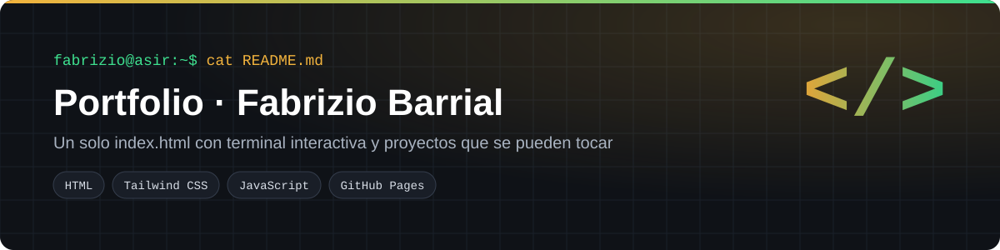
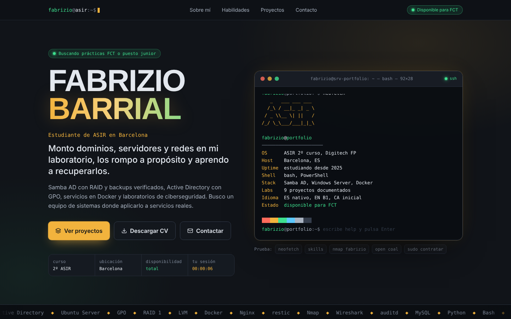
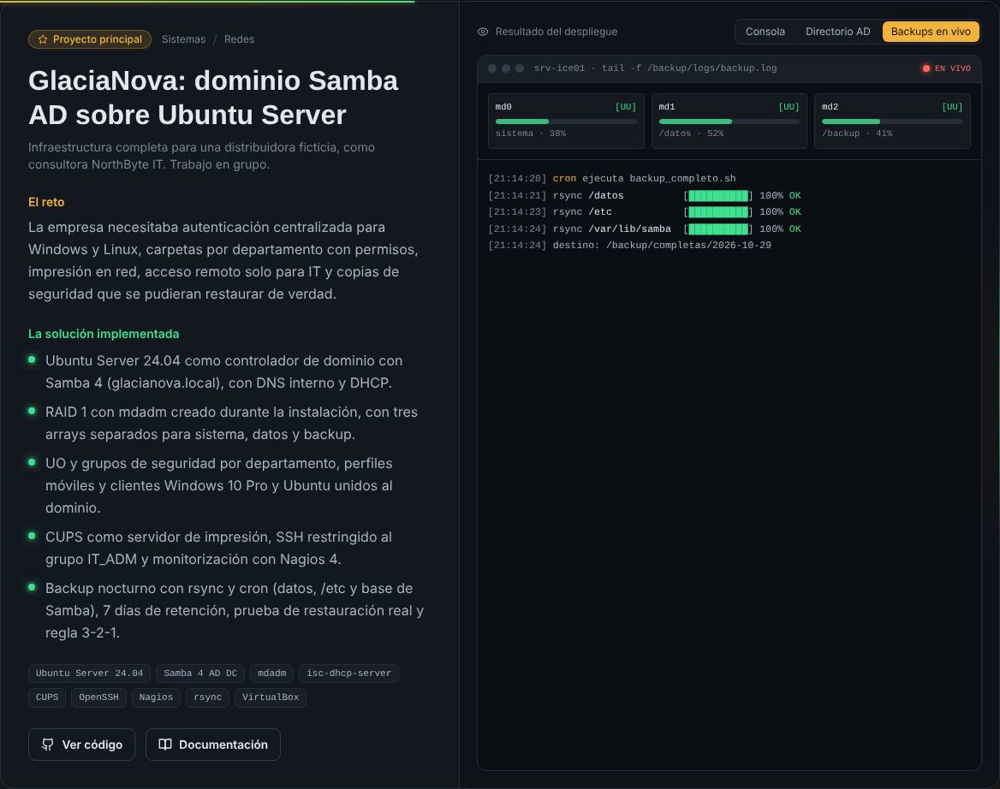
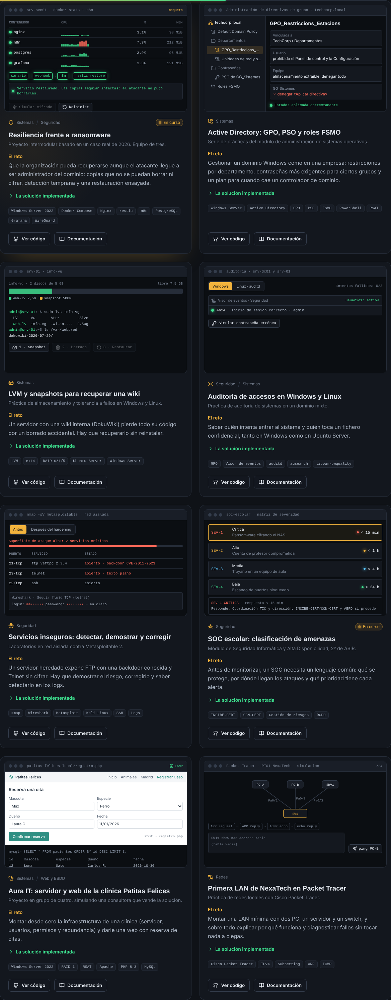
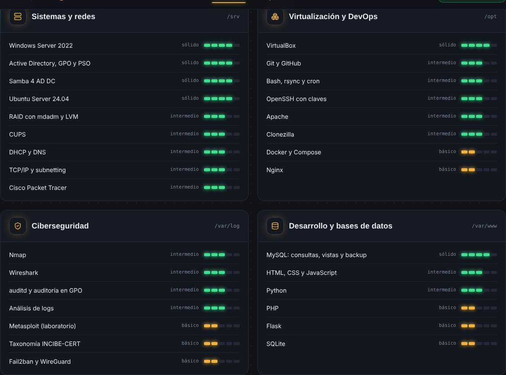
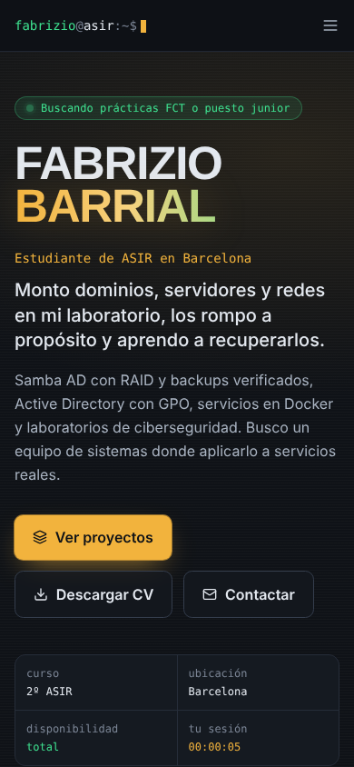
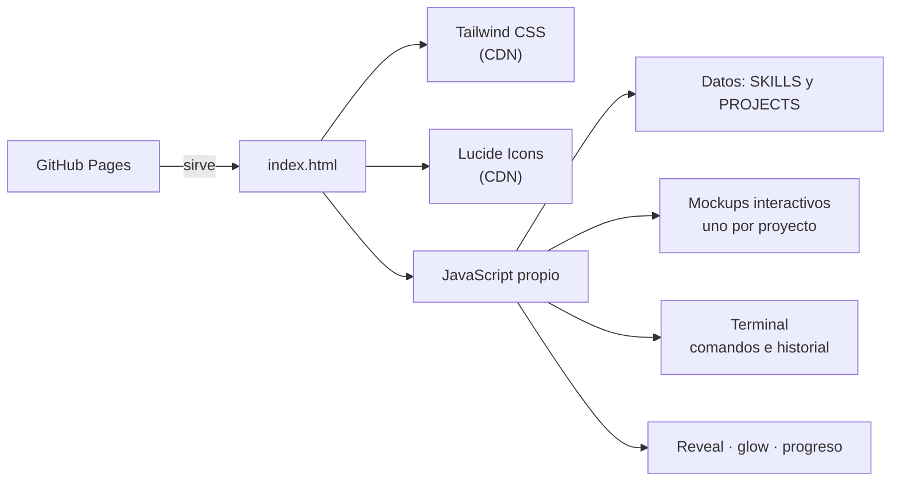

  
  
  
  

Mi portfolio profesional como estudiante de ASIR. Es un único `index.html`, sin compilación ni dependencias que instalar: Tailwind CSS y Lucide Icons por CDN, y el resto, JavaScript propio. Pensado para que un reclutador técnico entienda cada proyecto **sin tener que abrir GitHub**.

## Qué tiene

| Sección | Detalle |
|---|---|
| **Terminal interactiva** | Arranque tipo systemd y comandos reales: `help`, `whoami`, `neofetch` con arte ASCII, `skills`, `proyectos`, `open <proyecto>`, `nmap fabrizio`, `systemctl status fabrizio`, `ping`, `cv`… Con historial (↑ ↓), autocompletado con Tab y Ctrl+L |
| **Habilidades** | Cuatro categorías con medidores LED de 5 segmentos |
| **Proyectos** | Cada uno con una vista que se puede tocar: log de backups en vivo, árbol de AD, simulación de ransomware con restauración, consola de GPO, snapshot LVM paso a paso, bloqueo de cuenta, antes y después del hardening, formulario PHP y ping animado por un switch |
| **Contacto** | Correo con copia rápida, GitHub, LinkedIn y CV en PDF |
| **Detalles** | Borde iluminado que sigue al cursor, barra de progreso, apariciones al hacer scroll, adaptado a móvil y con respeto a "reducir movimiento" |

## Capturas

**Proyecto destacado con el log de backups en vivo**

**Laboratorios con vistas interactivas**

| Habilidades | Móvil |
|---|---|
|  |  |

## Arquitectura

Para añadir o cambiar un proyecto basta con editar el array `PROJECTS` (título, reto, solución, tecnologías, `repo` y `docs`) y, si se quiere, su entrada en `MOCKS`.

## Despliegue en GitHub Pages

1. Sube `index.html`, `CV_Fabrizio_Barrial.pdf`, `.nojekyll` y la carpeta `docs/` a la rama `main`.
2. *Settings › Pages › Build and deployment*: **Deploy from a branch**, rama `main`, carpeta `/ (root)`.
3. En uno o dos minutos queda publicado en **https://fabrizio2032-svc.github.io/portfolio/**.

### Conectar el dominio .es
1. *Settings › Pages › Custom domain*: escribe el dominio y pulsa **Save**. GitHub crea el fichero `CNAME`.
2. En el DNS del proveedor, crea los registros `A` del dominio raíz hacia las direcciones de GitHub Pages (guía oficial *Managing a custom domain for your GitHub Pages site*) y un `CNAME` de `www` a `fabrizio2032-svc.github.io`.
3. Cuando el dominio esté verificado, activa **Enforce HTTPS** y actualiza las tres URL de la cabecera de `index.html` (`canonical`, `og:url` y JSON-LD).

## Verificación

| Prueba | Resultado |
|---|---|
| Consola del navegador | Sin errores |
| Ancho de 390 px (móvil) | Sin scroll horizontal |
| `prefers-reduced-motion` | Sin animaciones; todo visible desde el inicio |
| Direcciones IP en el HTML | Ninguna |

---
**Autor:** Fabrizio Barrial · [fabriziobarrialtaipe@gmail.com](mailto:fabriziobarrialtaipe@gmail.com) · [LinkedIn](https://www.linkedin.com/in/fabriziobarrial) · [GitHub](https://github.com/fabrizio2032-SVC)
