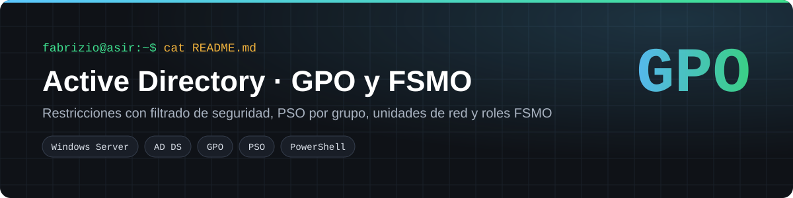
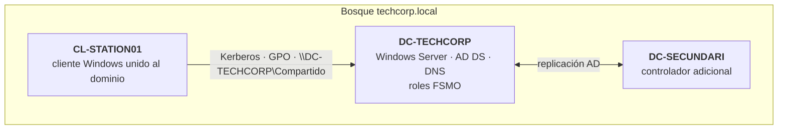
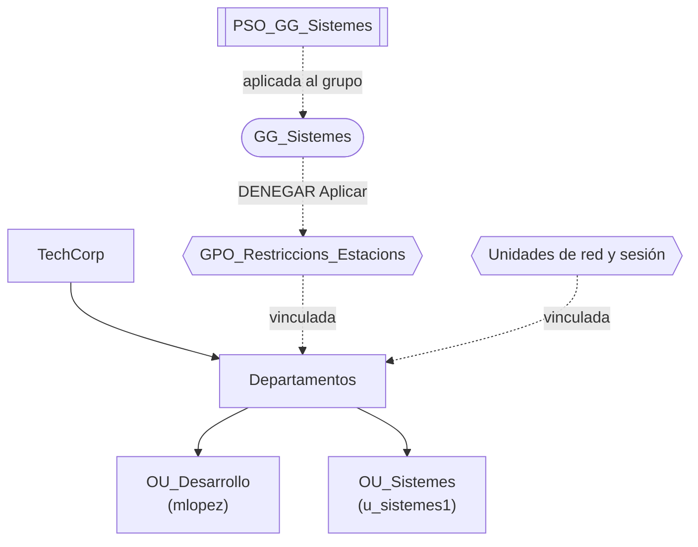
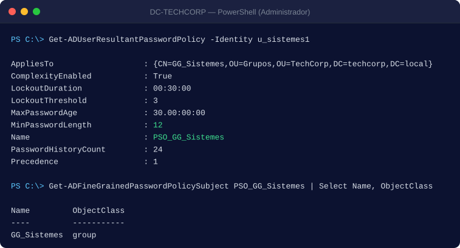
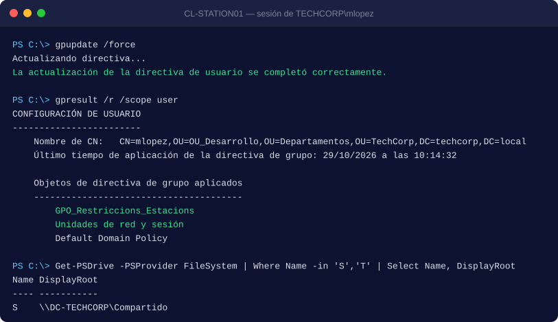
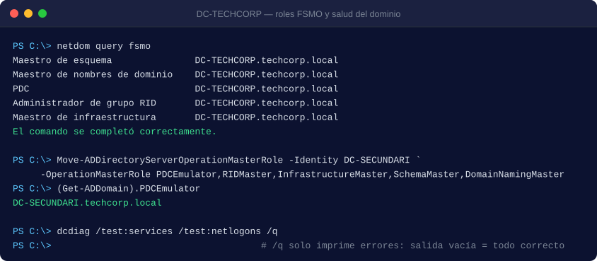

<p align="center"></p>

<p align="center">
  
  
  
  
</p>

Prácticas 1.2 y 1.3 del módulo 0374 *Administración de sistemas operativos* (2º ASIR, Digitech FP). Administré el dominio de laboratorio **`techcorp.local`** como en una empresa: restricciones a las estaciones sin molestar al equipo de sistemas, contraseñas más duras solo para un grupo, unidades de red automáticas y un plan para cuando cae un controlador de dominio.

## Índice
- [El reto](#el-reto)
- [Arquitectura](#arquitectura)
- [La solución](#la-solución)
- [Despliegue paso a paso](#despliegue-paso-a-paso)
- [Verificación](#verificación)
- [Conceptos clave](#conceptos-clave)
- [Estructura del repositorio](#estructura-del-repositorio)

## El reto

1. Bloquear el Panel de control y los USB en las estaciones, **pero no al grupo `GG_Sistemes`**.
2. Exigir contraseñas más estrictas **solo a `GG_Sistemes`**.
3. Repartir unidades de red y bloquear la sesión de forma automática.
4. Mantener el dominio: roles FSMO, papelera de AD, copia del estado del sistema y diagnóstico.

## Arquitectura





## La solución

| Necesidad | Qué configuré | Dónde |
|---|---|---|
| Restringir estaciones | Panel de control y Configuración prohibidos (usuario) y "almacenamiento extraíble: denegar todo" (equipo) | `GPO_Restriccions_Estacions` |
| Excepción para sistemas | `GG_Sistemes` con **Denegar** en "Aplicar directiva de grupo" | Delegación › Opciones avanzadas |
| Contraseñas por grupo | PSO con `New-ADFineGrainedPasswordPolicy`, asignada a `GG_Sistemes` | [`02_pso_gg_sistemes.ps1`](scripts/02_pso_gg_sistemes.ps1) |
| Unidades de red | **S:** y **T:** a `\\DC-TECHCORP\Compartido`; T: solo para `GG_Sistemes` (destinatarios de nivel de elemento) | Preferencias › Asignaciones de unidades |
| Bloqueo de sesión | Protector de pantalla con contraseña a los **600 s** | Panel de control › Personalización |
| Continuidad | Transferencia y confiscación de roles FSMO, papelera de AD y `wbadmin` | [`03_fsmo.ps1`](scripts/03_fsmo.ps1), [`04_papelera_y_backup.ps1`](scripts/04_papelera_y_backup.ps1) |

## Despliegue paso a paso

Todo se ejecuta en `DC-TECHCORP`, en PowerShell como administrador del dominio, salvo el último paso.

```powershell
# 1) GPO de restricciones vinculada a Departamentos
.\scripts\01_gpo_restricciones.ps1
#    Editar en gpmc.msc:
#    Usuario › Plantillas administrativas › Panel de control › "Prohibir el acceso a Configuración de PC y a Panel de control" = Habilitada
#    Equipo  › Plantillas administrativas › Sistema › Acceso a almacenamiento extraíble › "Todas las clases: denegar todo" = Habilitada
#    Delegación › Opciones avanzadas › Agregar GG_Sistemes › Aplicar directiva de grupo: Denegar

# 2) Política de contraseñas detallada para GG_Sistemes
.\scripts\02_pso_gg_sistemes.ps1

# 3) Unidades de red y protector de pantalla (gpmc.msc)
#    Usuario › Preferencias › Configuración de Windows › Asignaciones de unidades › Nueva:
#      Acción Actualizar · \\DC-TECHCORP\Compartido · letra S
#      Igual con letra T y, en Comunes, destinatario de nivel de elemento = grupo GG_Sistemes

# 4) Mantenimiento
.\scripts\03_fsmo.ps1                 # consulta y transferencia de roles
.\scripts\04_papelera_y_backup.ps1    # papelera de AD y estado del sistema

# 5) En CL-STATION01, con TECHCORP\mlopez
.\scripts\05_diagnostico.ps1          # gpupdate, gpresult y dcdiag
```

## Verificación

**La PSO se aplica al usuario de sistemas**



**GPO aplicadas y unidad de red montada en el cliente**



**Roles FSMO antes y después de la transferencia**



| Prueba | Resultado | Estado |
|---|---|:-:|
| `mlopez` (OU_Desarrollo) abre el Panel de control | Bloqueado por directiva | ✅ |
| `u_sistemes1` (GG_Sistemes) en la misma estación | Sin restricciones | ✅ |
| `Get-ADUserResultantPasswordPolicy u_sistemes1` | Devuelve `PSO_GG_Sistemes` | ✅ |
| Inicio de sesión en `CL-STATION01` | S: montada (y T: para sistemas) | ✅ |
| Memoria USB en una estación | Acceso denegado | ✅ |
| `Move-ADDirectoryServerOperationMasterRole` | El PDC pasa a `DC-SECUNDARI` | ✅ |
| Borrar un usuario y `Restore-ADObject` | El usuario vuelve con sus grupos | ✅ |

> Las capturas de consola están reproducidas en SVG a partir de las de la práctica.

## Conceptos clave

- **LSDOU:** las GPO se aplican en el orden local, sitio, dominio y OU, y gana la última. **Block Inheritance** corta la herencia en una OU; **Enforced** la atraviesa.
- **PSO a grupos y no a OU:** las OU no son principales de seguridad (no tienen SID). Así, dentro de una misma OU puede haber políticas de contraseña distintas.
- **Restauración autoritativa y no autoritativa:** la no autoritativa se pone al día replicando; la autoritativa incrementa el USN para imponer la versión restaurada, por ejemplo tras borrar por error una OU ya replicada.
- **Seize:** solo cuando el DC original no volverá; si vuelve, habría dos maestros del mismo rol.

Más detalle en [`docs/conceptos.md`](docs/conceptos.md).

## Estructura del repositorio

```
active-directory-gpo-fsmo/
├── scripts/
│   ├── 01_gpo_restricciones.ps1    Crear y vincular la GPO; revisar permisos
│   ├── 02_pso_gg_sistemes.ps1      PSO para GG_Sistemes
│   ├── 03_fsmo.ps1                 Consultar, transferir o confiscar roles
│   ├── 04_papelera_y_backup.ps1    Papelera de AD, Restore-ADObject y wbadmin
│   └── 05_diagnostico.ps1          dcdiag, repadmin, gpupdate y gpresult
└── docs/
    ├── conceptos.md                LSDOU, herencia, PSO y tipos de restauración
    └── img/
```

## Lo que aprendí

- Las GPO no se "ponen" a un usuario: se vinculan a contenedores y se filtran con permisos. Un **Denegar** bien puesto evita crear OU solo para excepciones.
- La regla LSDOU explica casi todos los "¿por qué no se aplica mi GPO?".
- Antes de confiscar un rol FSMO hay que estar seguro de que el DC original no volverá.

---
**Autoría:** Fabrizio Barrial · 2º ASIR, Digitech FP. Dominio y usuarios de laboratorio. · [Portfolio](https://fabrizio2032-svc.github.io/portfolio/)
