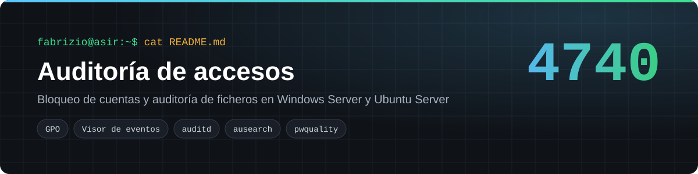
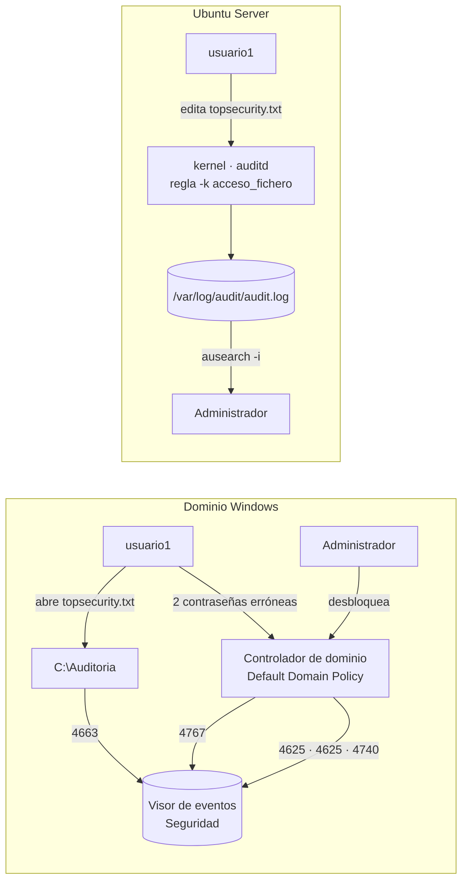
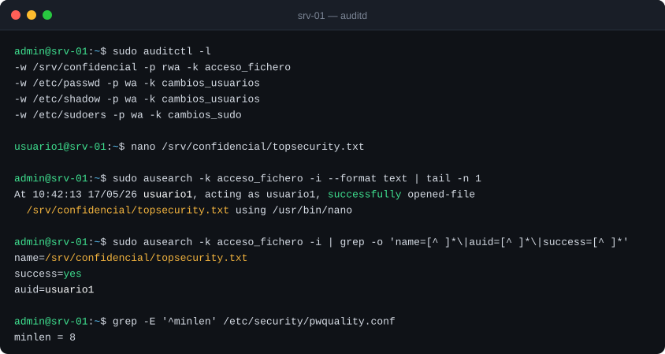
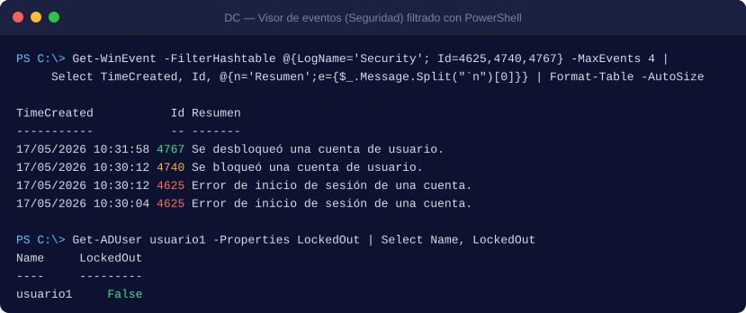

<p align="center"></p>

<p align="center">
  
  
  
</p>

Práctica AP1 del módulo 0369 *Implantación de sistemas operativos* (2º ASIR, Digitech FP). Resultado de aprendizaje 7: auditar el uso y el acceso a los recursos. El objetivo es saber **quién intenta entrar** al sistema y **quién toca un fichero confidencial**, en el dominio Windows y en el servidor Linux, con fecha y hora de cada evento.

## Índice
- [El reto](#el-reto)
- [Arquitectura](#arquitectura)
- [Despliegue paso a paso](#despliegue-paso-a-paso)
- [Verificación](#verificación)
- [Eventos que hay que conocer](#eventos-que-hay-que-conocer)
- [Estructura del repositorio](#estructura-del-repositorio)

## El reto

| Requisito | Windows Server | Ubuntu Server |
|---|---|---|
| Bloquear la fuerza bruta | Bloqueo tras **2 intentos**; solo el administrador desbloquea | — |
| Contraseñas mínimas | Directiva de dominio | `libpam-pwquality`, `minlen = 8` |
| Saber quién abre un fichero sensible | Auditoría de acceso a objetos sobre `topsecurity.txt` | Regla de `auditd` sobre `/srv/confidencial` |
| Registro consultable | Visor de eventos › Seguridad | `ausearch` y `aureport` |

## Arquitectura



## Despliegue paso a paso

### Windows Server (GPO del dominio)

1. `gpmc.msc` › **Default Domain Policy** › Configuración del equipo › Directivas › Configuración de Windows › Configuración de seguridad.
2. **Directivas de cuenta › Bloqueo de cuenta:** umbral **2** intentos y duración **0** (la cuenta queda bloqueada hasta que la desbloquea un administrador).
3. **Directivas locales › Directiva de auditoría:** inicio de sesión, administración de cuentas y acceso a objetos, en **Correcto** y **Error**.
4. Crea `C:\Auditoria\topsecurity.txt` › Propiedades › Seguridad › Opciones avanzadas › **Auditoría** › Agregar *Domain Users* en Correcto y Error.
5. Aplica con `gpupdate /force` y consulta con el filtro de PowerShell de [`windows/eventos-de-seguridad.md`](windows/eventos-de-seguridad.md).

### Ubuntu Server

```bash
sudo bash linux/instalar_y_probar_auditd.sh   # instala auditd y pwquality, carga las reglas y genera un evento de prueba
sudo sed -i 's/^# *minlen.*/minlen = 8/' /etc/security/pwquality.conf
sudo ausearch -k acceso_fichero -i | tail
sudo aureport -f --summary
```

Las reglas están en [`linux/audit.rules`](linux/audit.rules) y se instalan en `/etc/audit/rules.d/`, así que **sobreviven al reinicio** (las creadas con `auditctl` se pierden).

## Verificación

**Linux: reglas activas y rastro del acceso al fichero**



**Windows: dos fallos, bloqueo y desbloqueo**



| Prueba | Resultado | Estado |
|---|---|:-:|
| 2 contraseñas erróneas con `usuario1` | Eventos 4625 ×2 y 4740; cuenta bloqueada | ✅ |
| Desbloqueo por el administrador | Evento 4767; `LockedOut = False` | ✅ |
| Abrir `topsecurity.txt` | Evento 4663 con el usuario y la hora | ✅ |
| Alta y baja de un usuario de prueba | Eventos 4720 y 4726 | ✅ |
| Editar el fichero vigilado en Linux | `ausearch -k acceso_fichero` muestra usuario, hora y programa | ✅ |
| Contraseña de 6 caracteres en Linux | Rechazada por pwquality | ✅ |

> Las capturas de consola están reproducidas en SVG a partir de las de la práctica.

## Eventos que hay que conocer

| ID | Significado |
|---|---|
| 4624 | Inicio de sesión correcto |
| 4625 | Error de inicio de sesión |
| 4740 | Cuenta bloqueada |
| 4767 | Cuenta desbloqueada |
| 4720 · 4726 | Cuenta creada · eliminada |
| 4663 | Intento de acceso a un objeto auditado |

## Estructura del repositorio

```
auditoria-windows-linux/
├── linux/
│   ├── audit.rules                  Reglas persistentes de auditd
│   ├── pwquality.conf.extracto      minlen = 8
│   └── instalar_y_probar_auditd.sh  Instala, carga reglas y genera un evento
├── windows/
│   └── eventos-de-seguridad.md      Configuración de la GPO, IDs de evento y filtro en PowerShell
└── docs/img/
```

## Lo que aprendí

- Sin una **directiva de auditoría** activada, Windows no registra los accesos al fichero aunque se configure la auditoría en el propio fichero: hacen falta las dos cosas.
- En Linux, las reglas hechas con `auditctl` desaparecen al reiniciar; las persistentes van en `rules.d`.
- Un umbral de bloqueo bajo frena la fuerza bruta, pero genera llamadas a soporte. Hay que equilibrar seguridad y usabilidad.

---
**Autoría:** Fabrizio Barrial · 2º ASIR, Digitech FP. · [Portfolio](https://fabrizio2032-svc.github.io/portfolio/)
