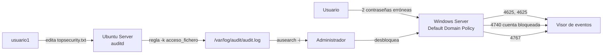

# Auditoría de accesos en Windows Server y Ubuntu Server

> Práctica AP1 del módulo 0369 *Implantación de sistemas operativos* (2º ASIR, Digitech FP). RA7: auditar el uso y el acceso a los recursos respetando las necesidades de seguridad del sistema.


## El reto

Saber **quién intenta entrar** al sistema y **quién toca un fichero confidencial**, tanto en el dominio Windows como en el servidor Linux, y dejar registro con fecha y hora.

## La solución

### Windows Server (dominio)
- **Bloqueo de cuenta tras 2 intentos fallidos** en la Default Domain Policy. Solo el administrador puede desbloquearla.
- **Directiva de auditoría** activada para inicios de sesión, administración de cuentas y acceso a objetos.
- **Auditoría sobre un fichero** (`topsecurity.txt`) para *Domain Users*, en accesos correctos y fallidos.
- Seguimiento en el Visor de eventos: 4625 → 4740 → 4767, además de 4720/4726 (alta y baja de usuarios) y 4663 (acceso al fichero). Tabla completa en [windows/eventos-de-seguridad.md](windows/eventos-de-seguridad.md).

### Ubuntu Server
- Longitud mínima de contraseña de 8 caracteres con **libpam-pwquality** (`minlen = 8`).
- **auditd** con reglas persistentes en `/etc/audit/rules.d/audit.rules`.
- Lectura de eventos con `ausearch -k acceso_fichero -i`. El `-i` traduce la marca de tiempo numérica a una fecha legible.



## Estructura

```
auditoria-windows-linux/
├── linux/
│   ├── audit.rules                  # Reglas persistentes de auditd
│   ├── pwquality.conf.extracto      # minlen = 8
│   └── instalar_y_probar_auditd.sh  # Instala, carga reglas y genera un evento de prueba
├── windows/
│   └── eventos-de-seguridad.md      # IDs de evento, configuración de la GPO y filtro en PowerShell
└── docs/capturas/
```

## Ejemplo de salida de `ausearch`

```
----
time->17/05/2026 10:42:13
type=PATH  name=/srv/confidencial/topsecurity.txt nametype=NORMAL
type=SYSCALL comm=nano exe=/usr/bin/nano auid=usuario1 success=yes
```

## Lo que aprendí

- Sin una directiva de auditoría activada, Windows **no registra** los accesos a ficheros aunque se configure la auditoría en el propio fichero: hacen falta las dos cosas.
- En Linux, las reglas creadas con `auditctl` se pierden al reiniciar. Para que sean persistentes van en `rules.d`.
- Un bloqueo con umbral bajo protege frente a fuerza bruta, pero genera trabajo de soporte. Hay que equilibrar seguridad y usabilidad.

## Autoría

Fabrizio Barrial · 2º ASIR, Digitech FP.
