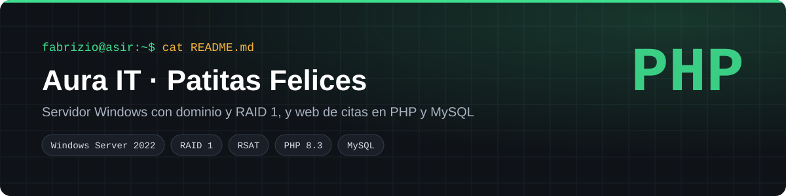
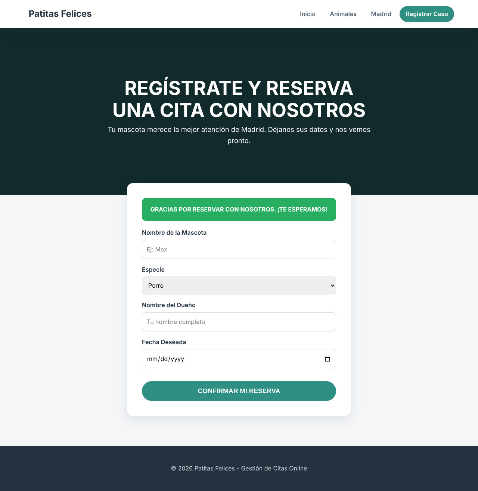
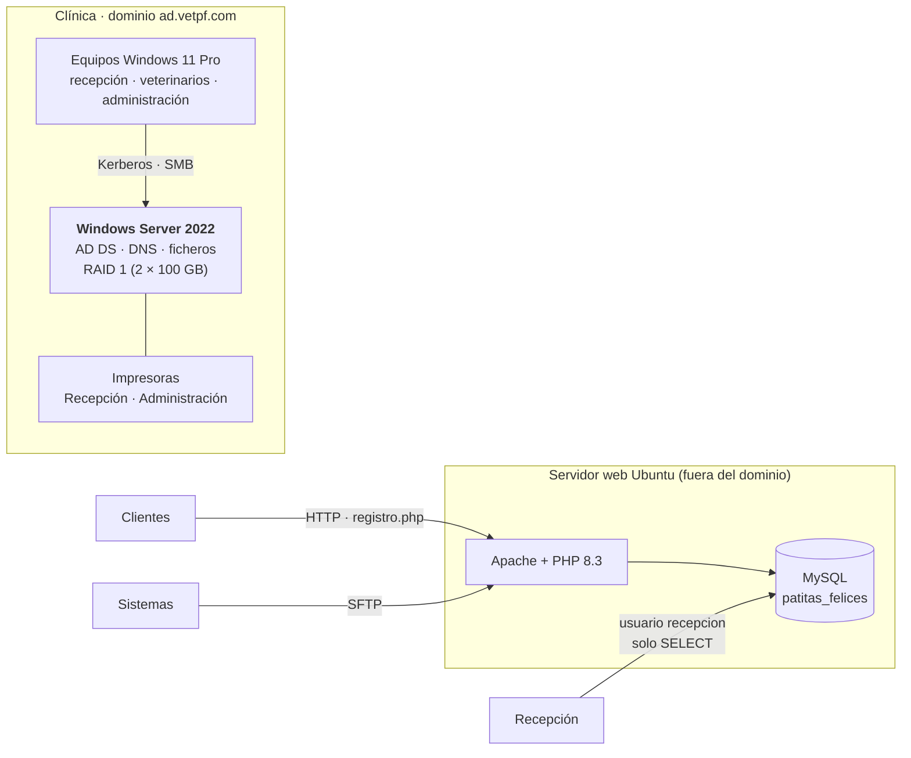
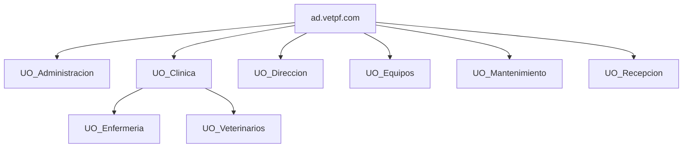
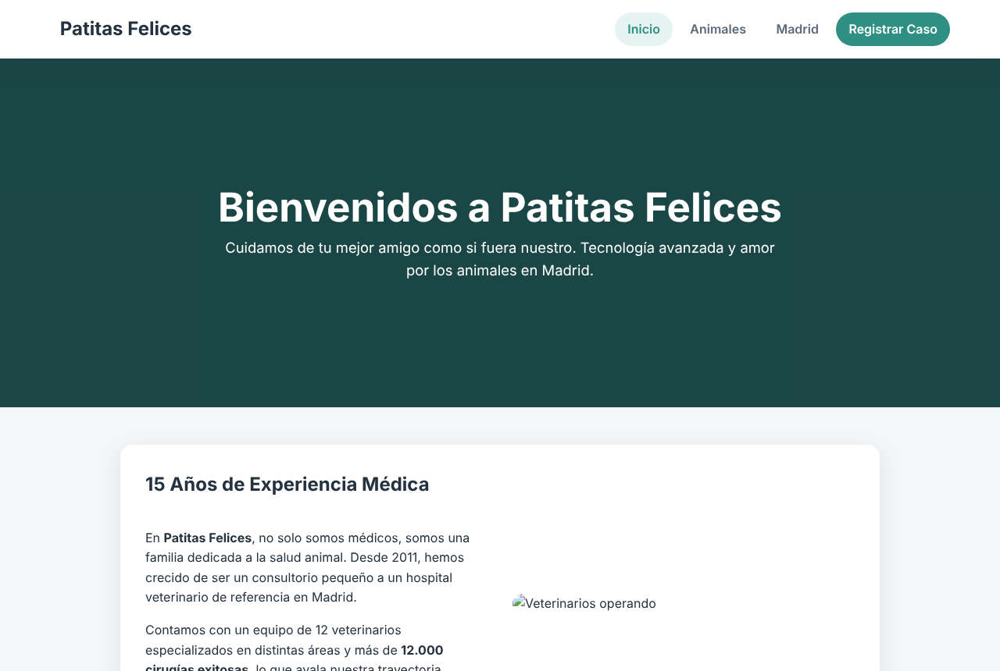
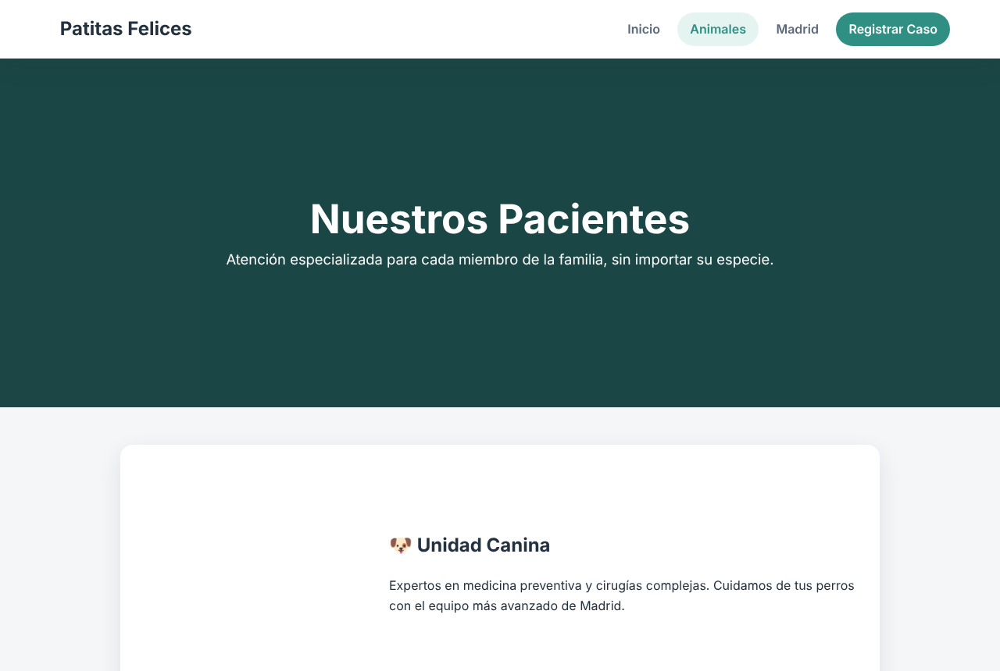
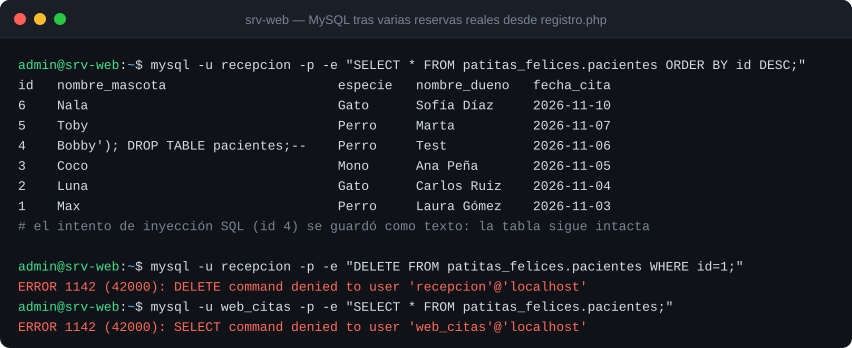

<p align="center"></p>

<p align="center">
  
  
  
  
  
</p>

Proyecto en grupo de cuatro de 2º ASIR (Digitech FP). Simulamos una consultora, **Aura IT**, que vende y monta la infraestructura de la clínica veterinaria **Patitas Felices**: un servidor Windows con dominio y redundancia, y una web en LAMP donde los clientes reservan cita.

<p align="center"></p>

## Índice
- [El reto](#el-reto)
- [Arquitectura](#arquitectura)
- [La solución](#la-solución)
- [Despliegue paso a paso](#despliegue-paso-a-paso)
- [Verificación](#verificación)
- [Mejoras de seguridad en el código](#mejoras-de-seguridad-en-el-código)
- [Estructura del repositorio](#estructura-del-repositorio)

## El reto

- Servidor con usuarios, grupos, permisos y carpetas compartidas por departamento.
- Que un disco roto **no pare la clínica**.
- Una web donde los clientes reserven cita y recepción pueda consultarlas **sin poder borrarlas**.

## Arquitectura





## La solución

| Parte | Qué monté |
|---|---|
| Servidor | Windows Server 2022 con experiencia de escritorio y **RAID 1** creado con PowerShell antes de instalar |
| Dominio | `ad.vetpf.com` con UO por departamento, grupos, usuarios y carpetas compartidas ([detalle](docs/infraestructura-windows.md)) |
| Recursos | Clientes, Pacientes, Historial clínico, Facturaciones, Proveedores, Administración y Común (con CREATOR OWNER) |
| Administración | **RSAT**: todo el equipo administraba el mismo servidor desde su equipo |
| Web | LAMP en Ubuntu: inicio, especialidades, ubicación y **formulario de citas** conectado por `mysqli` |
| Base de datos | Tabla `pacientes`, usuario `web_citas` **solo INSERT** y usuario `recepcion` **solo SELECT** |

## Despliegue paso a paso

```bash
# 1) Pila LAMP
sudo apt install -y apache2 php libapache2-mod-php php-mysql mysql-server

# 2) Base de datos y usuarios con mínimo privilegio
sudo mysql < sql/schema.sql
sudo bash sql/crear_usuarios.sh        # contraseñas aleatorias; las de la web van a Apache como SetEnv

# 3) Publicar la web
sudo cp -r web/* /var/www/html/
sudo rm -f /var/www/html/index.html    # quita la página por defecto de Apache
sudo systemctl reload apache2

# 4) Probar
curl -s -X POST http://localhost/registro.php \
  --data "nombre_mascota=Max&especie=Perro&nombre_dueno=Laura&fecha_cita=2026-11-03" | grep -o "GRACIAS[^<]*"
```

En el servidor Windows, el RAID 1 se creó con PowerShell sobre los dos discos de 100 GB antes de instalar los roles AD DS y Servidor de archivos. Después se crearon las UO, los grupos y los recursos compartidos (*Propiedades › Compartir › Uso compartido avanzado*).

## Verificación

**La web**

| Inicio | Especialidades |
|---|---|
|  |  |

**La base de datos tras varias reservas** (ejecución real contra MariaDB)



| Prueba | Resultado | Estado |
|---|---|:-:|
| Reserva válida desde el formulario | Fila nueva en `pacientes` y mensaje de confirmación | ✅ |
| Especie fuera de la lista | Rechazada con aviso; no se inserta nada | ✅ |
| Intento de inyección `Bobby'); DROP TABLE pacientes;--` | Se guarda como texto; la tabla sigue existiendo | ✅ |
| `recepcion` intenta `DELETE` | `ERROR 1142: DELETE command denied` | ✅ |
| `web_citas` intenta `SELECT` | `ERROR 1142: SELECT command denied` | ✅ |

## Mejoras de seguridad en el código

La primera versión de `registro.php` funcionaba, pero al revisarla para publicarla encontré tres problemas y los corregí:

| Problema | Antes | Ahora |
|---|---|---|
| Inyección SQL | Datos del formulario concatenados en el `INSERT` | **Consulta preparada** con `prepare` y `bind_param` |
| Credenciales | `root` sin contraseña escrito en el código | Usuario `web_citas` solo con INSERT; credenciales en variables de entorno de Apache |
| Errores | El error de MySQL se mostraba al visitante | Va al log del servidor y el visitante ve un mensaje genérico |

También corregí una coma sobrante en el `CREATE TABLE` original que impedía crear la tabla.

## Estructura del repositorio

```
clinica-veterinaria-lamp/
├── web/
│   ├── index.php · animales.php · ubicacion.php
│   ├── registro.php         Formulario de citas con consulta preparada
│   ├── config.php           Lee las credenciales del entorno (sin secretos)
│   └── estilos.css
├── sql/
│   ├── schema.sql           Base de datos y tabla pacientes
│   └── crear_usuarios.sh    Usuarios con mínimo privilegio y SetEnv para Apache
└── docs/
    ├── infraestructura-windows.md   RAID 1, dominio, UO, grupos y recursos
    └── img/
```

## Lo que aprendí

- Un formulario que "funciona" puede ser vulnerable: **nunca hay que concatenar datos del usuario en SQL**.
- El mínimo privilegio también vale para las bases de datos: cada uso tiene su propio usuario.
- Decidir **no** unir un servidor al dominio también es una decisión técnica que hay que justificar.

---
**Autoría:** Fabrizio Barrial y tres compañeros de 2º ASIR en Digitech FP. La clínica, la dirección y el teléfono son ficticios. · [Portfolio](https://fabrizio2032-svc.github.io/portfolio/)
