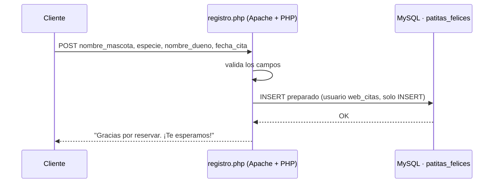

# Aura IT · servidor y web de la clínica veterinaria Patitas Felices

> Proyecto en grupo de cuatro de 2º ASIR (Digitech FP). Simulamos una consultora, **Aura IT**, que vende y monta la infraestructura de una clínica veterinaria: servidor Windows con dominio, redundancia y una web de citas en LAMP.


## El reto

Montar desde cero lo que necesita una clínica pequeña pero profesional:

- Servidor con usuarios, grupos, permisos y carpetas compartidas por departamento.
- Que un disco roto no pare la clínica.
- Una web donde los clientes reserven cita y recepción pueda consultarlas.

## La solución

| Parte | Qué monté |
|---|---|
| Servidor | Windows Server 2022 con **RAID 1** en dos discos de 100 GB |
| Dominio | `ad.vetpf.com` con UO por departamento, grupos, usuarios y carpetas compartidas con permisos ([detalle](docs/infraestructura-windows.md)) |
| Administración | **RSAT** para que todo el equipo administrara el mismo servidor desde su equipo |
| Web | LAMP en Ubuntu: **PHP 8.3 + MySQL**, con formulario de citas conectado por `mysqli` |
| Seguridad | Usuario de MySQL de **solo lectura** para recepción, de **solo inserción** para la web y **SFTP** para el administrador |

## La web

| Página | Contenido |
|---|---|
| `index.php` | Portada con hero, experiencia, tecnología, misión y visión |
| `animales.php` | Especialidades: perros, gatos, primates exóticos y pequeños mamíferos |
| `ubicacion.php` | Dirección, mapa, contacto y horarios |
| `registro.php` | **Formulario de cita que guarda en la tabla `pacientes`** |



## Qué mejoré al revisar el código para publicarlo

La primera versión de `registro.php` funcionaba, pero al repasarla encontré tres problemas de seguridad y los corregí:

1. **Inyección SQL:** los datos del formulario se metían directamente en la consulta. Ahora se usa una **consulta preparada** (`prepare` + `bind_param`).
2. **Credenciales en el código y usuario `root`:** ahora están en `config.php`, que no se sube al repositorio, y se usa un usuario con permisos mínimos ([sql/usuarios.sql](sql/usuarios.sql)).
3. **Errores visibles:** el error de MySQL se mostraba al visitante. Ahora va al log del servidor y el usuario ve un mensaje genérico.

Además corregí una coma sobrante en el `CREATE TABLE` original que impedía crear la tabla.

## Cómo probarlo

```bash
sudo apt install apache2 php libapache2-mod-php php-mysql mysql-server
sudo mysql < sql/schema.sql
sudo mysql < sql/usuarios.sql          # cambia antes las contraseñas
sudo cp -r web/* /var/www/html/
sudo cp /var/www/html/config.example.php /var/www/html/config.php   # y rellénalo
# Abrir http://<servidor>/registro.php
```

## Estructura

```
clinica-veterinaria-lamp/
├── web/            # index, animales, ubicacion, registro, estilos.css y config.example.php
├── sql/            # schema.sql y usuarios.sql (mínimo privilegio)
└── docs/
    ├── infraestructura-windows.md   # RAID 1, dominio, UO, grupos y recursos
    └── capturas/
```

## Lo que aprendí

- Un formulario que "funciona" puede ser vulnerable: **nunca hay que concatenar datos del usuario en SQL**.
- El mínimo privilegio también se aplica a las bases de datos: cada uso tiene su propio usuario de MySQL.
- Decidir **no** unir un servidor al dominio también es una decisión técnica que hay que justificar.

## Autoría

Fabrizio Barrial y tres compañeros de 2º ASIR en Digitech FP. La clínica, la dirección y el teléfono son ficticios.
