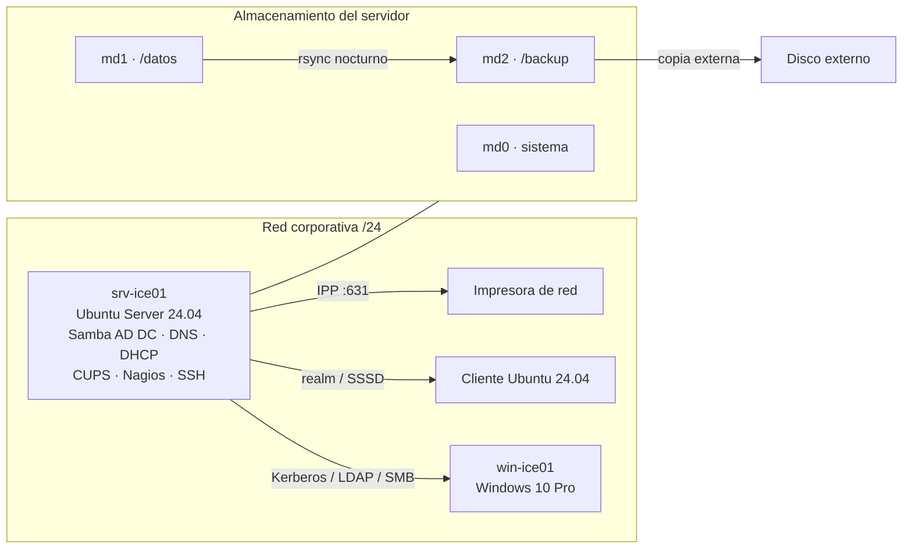

# GlaciaNova · Dominio Samba AD sobre Ubuntu Server

> Proyecto de 2º de ASIR (Digitech FP, Barcelona). Infraestructura de servidor completa para una distribuidora ficticia, montada en VirtualBox. Trabajo en grupo de cuatro.


## El reto

GlaciaNova Distribución S.L. necesitaba:

- Autenticación centralizada para equipos Windows y Linux.
- Carpetas por departamento, cada una accesible solo por su grupo.
- Impresión en red con permisos por grupo.
- Acceso remoto al servidor solo para el departamento de IT.
- Monitorización con alertas.
- Copias de seguridad que se puedan restaurar de verdad, no solo "que se hagan".

## La solución

| Área | Qué monté |
|---|---|
| Directorio | Ubuntu Server 24.04 como **controlador de dominio Samba 4** (`glacianova.local`), DNS interno de Samba |
| Red | **DHCP** con `isc-dhcp-server` e IP fija del servidor con Netplan |
| Almacenamiento | **RAID 1 con mdadm** creado durante la instalación, con tres arrays: sistema, `/datos` y `/backup` |
| Organización | UO y grupos de seguridad por departamento (Ventas, Logística, Administración e IT) y perfiles móviles |
| Recursos | Carpetas compartidas con doble capa de permisos: POSIX (`chmod 2770`) y SMB (`valid users`) |
| Impresión | **CUPS** publicado en la red, con ACL por grupo |
| Acceso remoto | **SSH** restringido con `AllowGroups IT_ADM`, sin acceso root |
| Monitorización | **Nagios 4**: host, SSH, Samba y espacio en disco de los arrays |
| Backups | Script con **rsync y cron**, 7 días de retención, prueba de restauración real y copia externa (regla 3-2-1) |

## Arquitectura



## Estructura del repositorio

```
glacianova-samba-ad/
├── README.md
├── config/
│   ├── dhcpd.conf                 # Subred, rango y opciones de dominio
│   ├── netplan-servidor.yaml      # IP fija del servidor
│   ├── netplan-cliente.yaml       # Clientes Ubuntu por DHCP
│   ├── smb.conf.recursos          # Recursos compartidos añadidos al smb.conf
│   ├── sshd_config.d/it-adm.conf  # SSH solo para IT_ADM
│   └── cupsd.conf.extracto        # CUPS escuchando en la red
├── scripts/
│   ├── crear_estructura_ad.sh     # UO, grupos y carpetas con permisos
│   ├── backup_completo.sh         # Copia nocturna con rsync y retención
│   └── prueba_restauracion.sh     # Simula una pérdida y la restaura
└── docs/
    ├── memoria-tecnica.md         # Memoria técnica completa del proyecto
    └── capturas/                  # Capturas (sin IPs visibles)
```

> En todos los ficheros las direcciones IP aparecen como marcadores (`<IP_SRV_ICE01>`, `<RED_LAN>`…). Las contraseñas no están en el repositorio.

## Cómo reproducirlo

1. **Instalación con RAID:** instala Ubuntu Server 24.04 en una VM con dos discos. Crea las particiones iguales en ambos y los arrays `md0`, `md1` y `md2` desde el instalador ("Create software RAID (md)").
2. **Red:** asigna la IP fija con `config/netplan-servidor.yaml` y aplica con `sudo netplan apply`.
3. **Dominio:** instala `samba krb5-user winbind`, detén `smbd nmbd winbind`, mueve el `smb.conf` original y provisiona el dominio:
   ```bash
   sudo samba-tool domain provision --use-rfc2307 --interactive
   sudo cp /var/lib/samba/private/krb5.conf /etc/krb5.conf
   sudo systemctl unmask samba-ad-dc && sudo systemctl enable --now samba-ad-dc
   ```
4. **Estructura:** ejecuta `scripts/crear_estructura_ad.sh` y añade `config/smb.conf.recursos` al final de `/etc/samba/smb.conf`.
5. **DHCP, CUPS, SSH y Nagios:** copia cada fichero de `config/` a su ruta y reinicia el servicio.
6. **Backups:** copia `scripts/backup_completo.sh` a `/usr/local/sbin/` y prográmalo:
   ```cron
   0 2 * * * /usr/local/sbin/backup_completo.sh
   ```

## Pruebas realizadas

| Prueba | Resultado esperado | Estado |
|---|---|---|
| `cat /proc/mdstat` | `[UU]` en md0, md1 y md2 | ✅ |
| `samba-tool domain level show` | Dominio GLACIANOVA activo | ✅ |
| Unión de `win-ice01` al dominio | Inicio de sesión con usuario del dominio y perfil móvil | ✅ |
| Usuario de Ventas en `\\srv-ice01\ventas` | Lectura y escritura | ✅ |
| Usuario de Logística en `\\srv-ice01\ventas` | Acceso denegado | ✅ |
| SSH con usuario de IT_ADM | Conexión correcta | ✅ |
| SSH con usuario de Ventas | `Permission denied` | ✅ |
| Parar SSH a propósito | Nagios marca el servicio en CRÍTICO | ✅ |
| Borrar un fichero y restaurarlo desde `/backup` | Contenido idéntico al original | ✅ |

## Problemas encontrados

- **RAID después de instalar:** pasar un sistema ya instalado a RAID es arriesgado y puede dejar el servidor sin arrancar. Por eso el RAID se creó durante la instalación, con la partición EFI replicada en ambos discos.
- **Permisos que no cuadraban:** si `smb.conf` permite el acceso pero el `chmod` no, el usuario recibe "Acceso denegado". Las dos capas tienen que estar alineadas.
- **Clientes sin dominio:** si el cliente no usa el DNS de Samba, no encuentra `glacianova.local`. El DHCP reparte ese DNS y se comprueba con `resolvectl status`.

## Lo que aprendí

- Samba AD hace en Linux el mismo trabajo que Active Directory en Windows Server, sin licencias de servidor.
- El RAID protege frente a un fallo de disco, pero **no sustituye al backup**. Hace falta una copia separada y, sobre todo, probar la restauración.
- Documentar cada paso me permitió repetir la instalación desde cero sin errores.

## Autoría

Fabrizio Barrial, con mi equipo de 2º de ASIR en Digitech FP. Proyecto académico: el nombre de la empresa y los datos son ficticios.
