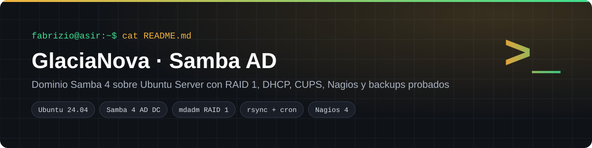
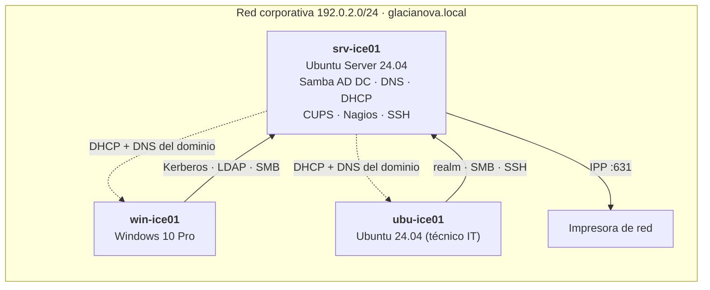
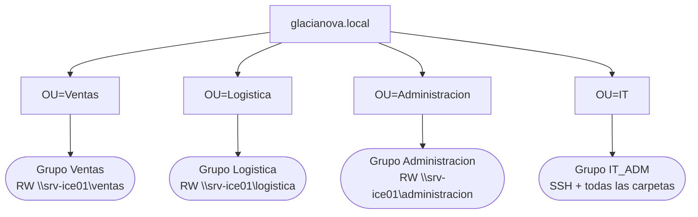
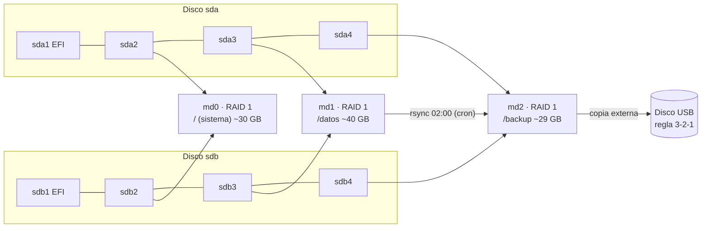
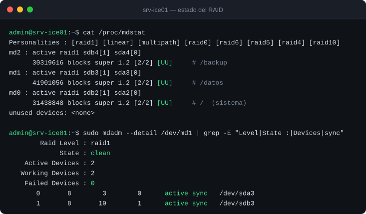
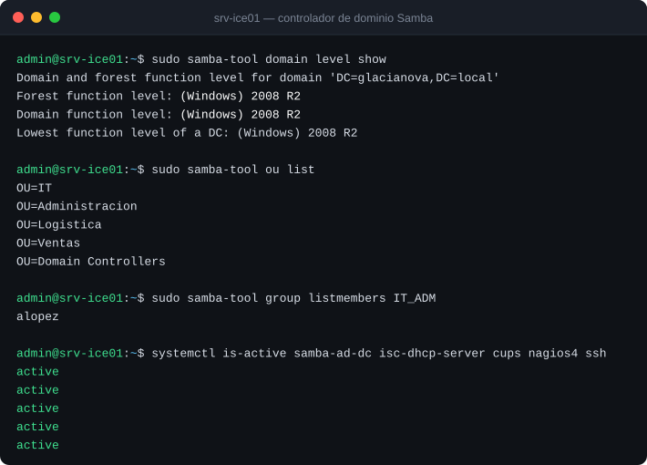
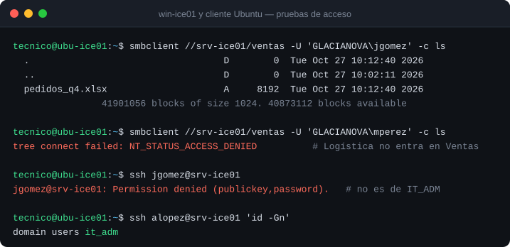
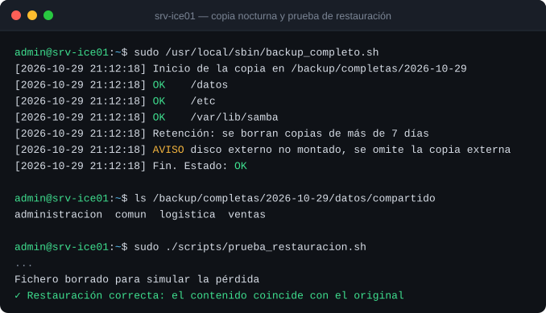

<p align="center"></p>

<p align="center">
  
  
  
  
  
</p>

Proyecto de 2º de ASIR (Digitech FP, Barcelona). Monté la infraestructura de servidor completa de **GlaciaNova Distribución S.L.**, una distribuidora ficticia, como si fuéramos la consultora *NorthByte IT*. Un único servidor Ubuntu hace de **controlador de dominio Samba 4**, servidor de ficheros, DHCP, impresión y monitorización, con **RAID 1** y **copias de seguridad verificadas**. Todo en VirtualBox y en grupo de cuatro.

## Índice
- [El reto](#el-reto)
- [Arquitectura](#arquitectura)
- [La solución](#la-solución)
- [Despliegue paso a paso](#despliegue-paso-a-paso)
- [Verificación](#verificación)
- [Problemas que resolví](#problemas-que-resolví)
- [Estructura del repositorio](#estructura-del-repositorio)

## El reto

| Necesidad del cliente | Cómo lo resolví |
|---|---|
| Un usuario y una contraseña para entrar en cualquier equipo, Windows o Linux | Dominio `glacianova.local` con Samba 4 AD DC |
| Que cada departamento vea solo sus carpetas | Recursos SMB con doble capa de permisos |
| Que un disco roto no pare la empresa | RAID 1 con mdadm en tres arrays |
| Imprimir desde cualquier puesto, con control | CUPS con ACL por grupo |
| Que solo IT administre el servidor | SSH con `AllowGroups IT_ADM` |
| Enterarse de los fallos antes que los usuarios | Nagios 4 con alertas |
| Copias que se puedan restaurar de verdad | rsync + cron, 7 días de retención, prueba de restauración y regla 3-2-1 |

## Arquitectura

### Red y servicios



### Directorio activo



### Almacenamiento y copias



## La solución

| Servicio | Paquete | Puerto | Función |
|---|---|---|---|
| Controlador de dominio | `samba-ad-dc` | 389 LDAP · 88 Kerberos · 445 SMB | Autenticación centralizada y directorio |
| DNS | Samba Internal DNS | 53 | Resolución de `glacianova.local` |
| DHCP | `isc-dhcp-server` | 67/udp | Reparto de IP y DNS del dominio |
| Ficheros | Samba (SMB/CIFS) | 445 | Carpetas por departamento y perfiles móviles |
| Impresión | CUPS | 631 | Impresoras publicadas con ACL por grupo |
| Acceso remoto | OpenSSH | 22 | Solo grupo `IT_ADM`, sin root |
| Monitorización | Nagios 4 | 80 | Host, SSH, Samba y espacio de `/datos` y `/backup` |
| Copias | rsync + cron | — | Nocturna, 7 días de retención y copia externa |

**Matriz de permisos**

| Grupo | `\\ventas` | `\\logistica` | `\\administracion` | `\\comun` | SSH |
|---|:-:|:-:|:-:|:-:|:-:|
| Ventas | ✅ RW | ❌ | ❌ | ✅ RW | ❌ |
| Logistica | ❌ | ✅ RW | ❌ | ✅ RW | ❌ |
| Administracion | ❌ | ❌ | ✅ RW | ✅ RW | ❌ |
| IT_ADM | ✅ RW | ✅ RW | ✅ RW | ✅ RW | ✅ |

## Despliegue paso a paso

**1. Instalación con RAID.** En el instalador de Ubuntu Server 24.04, con dos discos, crea en cada uno una partición EFI y tres de datos iguales. Después crea `md0`, `md1` y `md2` con *Create software RAID (md)* y móntalos en `/`, `/datos` y `/backup` (ext4).

**2. Red fija** con [`config/netplan-servidor.yaml`](config/netplan-servidor.yaml):
```bash
sudo cp config/netplan-servidor.yaml /etc/netplan/00-installer-config.yaml
sudo netplan apply
sudo hostnamectl set-hostname srv-ice01
```

**3. Controlador de dominio:**
```bash
sudo apt install -y samba krb5-user winbind libnss-winbind libpam-winbind
sudo systemctl disable --now smbd nmbd winbind
sudo mv /etc/samba/smb.conf /etc/samba/smb.conf.bak
sudo samba-tool domain provision --use-rfc2307 --realm=GLACIANOVA.LOCAL \
     --domain=GLACIANOVA --server-role=dc --dns-backend=SAMBA_INTERNAL
sudo cp /var/lib/samba/private/krb5.conf /etc/krb5.conf
sudo systemctl unmask samba-ad-dc && sudo systemctl enable --now samba-ad-dc
```

**4. Estructura y carpetas compartidas:**
```bash
sudo bash scripts/crear_estructura_ad.sh                       # UO, grupos y carpetas (chmod 2770)
sudo tee -a /etc/samba/smb.conf < config/smb.conf.recursos     # recursos con valid users
sudo systemctl restart samba-ad-dc
```

**5. DHCP, SSH y CUPS:**
```bash
sudo apt install -y isc-dhcp-server cups
sudo cp config/dhcpd.conf /etc/dhcp/dhcpd.conf && sudo systemctl restart isc-dhcp-server
sudo cp config/sshd_config.d/it-adm.conf /etc/ssh/sshd_config.d/ && sudo sshd -t && sudo systemctl restart ssh
# Añade las directivas de config/cupsd.conf.extracto a /etc/cups/cupsd.conf y reinicia cups
```

**6. Monitorización:** `sudo apt install -y nagios4 nagios-plugins-contrib` y definición de host, SSH, Samba y discos (umbral de aviso al 80 % y crítico al 90 %).

**7. Copias de seguridad:**
```bash
sudo install -m 750 scripts/backup_completo.sh /usr/local/sbin/
echo "0 2 * * * root /usr/local/sbin/backup_completo.sh" | sudo tee /etc/cron.d/backup-glacianova
sudo bash scripts/prueba_restauracion.sh
```

**8. Clientes:** el cliente Windows 10 Pro se une a `glacianova.local` desde *Sistema › Acerca de › Cambiar*. El cliente Ubuntu recibe la IP y el DNS por DHCP ([`config/netplan-cliente.yaml`](config/netplan-cliente.yaml)) y se une con `realm join glacianova.local`.

## Verificación

**RAID 1 sano en los tres arrays**



**Dominio, estructura y servicios activos**



**Permisos: cada departamento entra solo en lo suyo**



**Copia nocturna y prueba de restauración** (ejecución real de los scripts del repositorio)



| Prueba | Resultado esperado | Estado |
|---|---|:-:|
| `cat /proc/mdstat` | `[UU]` en md0, md1 y md2 | ✅ |
| `samba-tool domain level show` | Dominio GLACIANOVA operativo | ✅ |
| Inicio de sesión en `win-ice01` con `GLACIANOVA\jgomez` | Perfil móvil cargado | ✅ |
| Ventas → `\\srv-ice01\ventas` | Lectura y escritura | ✅ |
| Logística → `\\srv-ice01\ventas` | `NT_STATUS_ACCESS_DENIED` | ✅ |
| SSH con un usuario de IT_ADM | Conexión correcta | ✅ |
| SSH con un usuario de Ventas | `Permission denied` | ✅ |
| Parar SSH a propósito | Nagios lo marca en **CRÍTICO** | ✅ |
| Borrar un fichero y restaurarlo | Hash SHA-256 idéntico al original | ✅ |

> Las capturas de consola están reproducidas en SVG a partir de las de la práctica. La del backup es una ejecución real de los scripts de este repositorio.

## Problemas que resolví

- **RAID después de instalar:** convertir un sistema ya instalado a RAID puede dejarlo sin arrancar. Lo creé durante la instalación, con la partición EFI en los dos discos.
- **"Acceso denegado" con el permiso bien puesto en Samba:** faltaba alinear la capa POSIX. Se resolvió con `chown root:"GLACIANOVA\Grupo"` y `chmod 2770`; el bit SETGID hace que los ficheros nuevos hereden el grupo.
- **Clientes que no encontraban el dominio:** usaban otro DNS. El DHCP reparte el DNS del controlador y se comprueba con `resolvectl status`.

## Estructura del repositorio

```
glacianova-samba-ad/
├── config/
│   ├── dhcpd.conf                 Subred, rango y opciones del dominio
│   ├── netplan-servidor.yaml      IP fija del controlador
│   ├── netplan-cliente.yaml       Clientes Ubuntu por DHCP
│   ├── smb.conf.recursos          Recursos compartidos con valid users
│   ├── sshd_config.d/it-adm.conf  SSH solo para IT_ADM
│   └── cupsd.conf.extracto        CUPS escuchando en la LAN
├── scripts/
│   ├── crear_estructura_ad.sh     UO, grupos y carpetas con permisos
│   ├── backup_completo.sh         Copia nocturna, retención y copia externa
│   └── prueba_restauracion.sh     Borra un fichero y comprueba que vuelve idéntico
└── docs/
    ├── memoria-tecnica.md         Memoria técnica completa
    └── img/                       Diagramas y capturas
```

Las direcciones usan los rangos de documentación **RFC 5737**, reservados para ejemplos: no se publica el direccionamiento real del laboratorio. Las contraseñas no aparecen en ningún fichero.

## Lo que aprendí

- Samba AD hace en Linux el trabajo de Active Directory, sin licencias de servidor.
- **RAID no es backup:** protege del fallo de un disco, no de un borrado ni de un ransomware.
- Una copia solo cuenta si se ha restaurado alguna vez: por eso la prueba con hash forma parte del proyecto.

---
**Autoría:** Fabrizio Barrial con su equipo de 2º de ASIR en Digitech FP. La empresa y los datos son ficticios. · [Portfolio](https://fabrizio2032-svc.github.io/portfolio/) · [LinkedIn](https://www.linkedin.com/in/fabriziobarrial)
