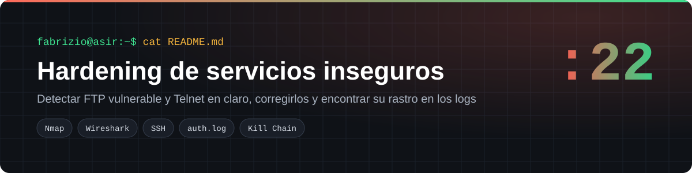
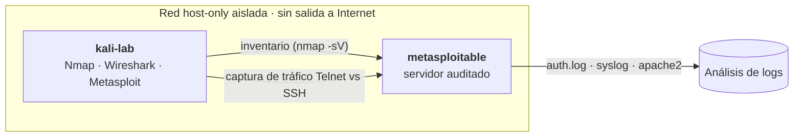
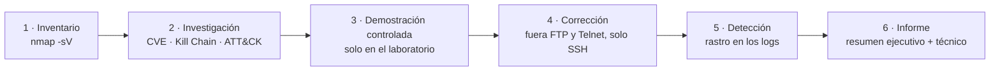
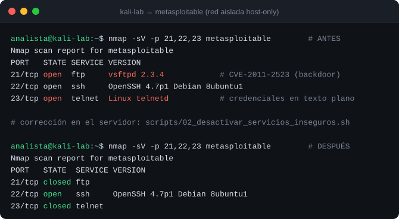
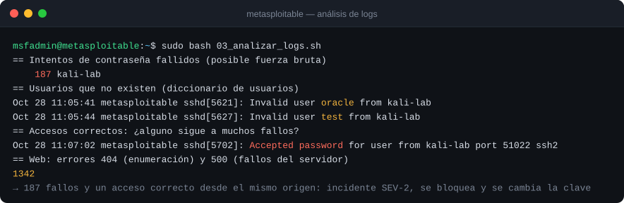

<p align="center"></p>

<p align="center">
  
  
  
  
</p>

Laboratorios del módulo *Python y Ciberseguridad* (2º ASIR, Digitech FP), hechos en una **red aislada (host-only)** contra Metasploitable 2, una máquina vulnerable creada a propósito para practicar. El enfoque es **defensivo**: encontrar el riesgo, demostrarlo a un responsable, corregirlo y saber detectarlo en los logs.

## Índice
- [El reto](#el-reto)
- [Arquitectura del laboratorio](#arquitectura-del-laboratorio)
- [Metodología](#metodología)
- [Despliegue paso a paso](#despliegue-paso-a-paso)
- [Verificación](#verificación)
- [Estructura del repositorio](#estructura-del-repositorio)

## El reto

Un servidor heredado expone dos servicios antiguos:

| Puerto | Servicio | Riesgo | CIA afectada |
|---|---|---|---|
| 21/tcp | vsftpd 2.3.4 | Versión con una **backdoor conocida** (CVE-2011-2523): comandos sin autenticación | Confidencialidad, integridad y disponibilidad |
| 23/tcp | Telnet | Usuario, contraseña y comandos viajan **en texto plano** | Confidencialidad |

## Arquitectura del laboratorio



## Metodología



| Fase | Qué hice |
|---|---|
| Inventario | `nmap -sV` para identificar servicios y versiones |
| Investigación | El CVE en la base de MITRE; la fase de la **Cyber Kill Chain** (explotación) y la técnica de **MITRE ATT&CK** correspondiente |
| Demostración | Verificación controlada del riesgo con Metasploit y captura con **Wireshark** ("Seguir flujo TCP") de las credenciales de Telnet en claro, comparadas con una sesión SSH en la que solo hay tráfico cifrado |
| Corrección | Desactivar vsftpd y Telnet y dejar **SSH** como única vía de administración |
| Detección | Fallos de contraseña, usuarios inexistentes, accesos tras muchos fallos y errores 404/500 en Apache |
| Informe | [Informe del incidente](docs/informe-incidente.md) con resumen ejecutivo, cronología y medidas |

## Despliegue paso a paso

```bash
# En la máquina de análisis: inventario y comprobación de puertos en claro
bash scripts/01_inventario_servicios.sh metasploitable

# En el servidor auditado: contramedida
sudo bash scripts/02_desactivar_servicios_inseguros.sh
ss -tulpn | grep -E ':(21|22|23)\b'          # solo debe quedar el 22

# En el servidor auditado: buscar el rastro
sudo bash scripts/03_analizar_logs.sh
```

## Verificación

**Antes y después del hardening**



**El rastro en los logs**



| Prueba | Antes | Después |
|---|---|---|
| `21/tcp` | 🔴 abierto · vsftpd 2.3.4 | 🟢 cerrado |
| `23/tcp` | 🔴 abierto · Telnet | 🟢 cerrado |
| `22/tcp` | abierto | 🟢 abierto, cifrado, única vía de administración |
| Wireshark sobre una sesión Telnet | usuario y contraseña legibles | — |
| Wireshark sobre una sesión SSH | — | solo tráfico cifrado |

> Las capturas de consola están reproducidas en SVG a partir de las de la práctica.

## Estructura del repositorio

```
hardening-servicios-inseguros/
├── scripts/
│   ├── 01_inventario_servicios.sh            ss, nmap -sV y puertos en claro
│   ├── 02_desactivar_servicios_inseguros.sh  Contramedida: fuera FTP y Telnet
│   └── 03_analizar_logs.sh                   Rastro en auth.log, syslog y Apache
└── docs/
    ├── informe-incidente.md                  Informe del incidente del laboratorio
    └── img/
```

## Lo que aprendí

- **Versión vieja es riesgo**, aunque el servicio "funcione": un inventario con versiones es el primer paso de cualquier hardening.
- La diferencia entre Telnet y SSH se ve en diez segundos con Wireshark, y eso convence más que cualquier explicación.
- Un sistema sin monitorización de logs es como una tienda sin cámaras: los ataques ocurren y nadie se entera.

> Todo se hizo en máquinas virtuales propias y aisladas. Este repositorio documenta la **detección y la corrección**, no paso a paso cómo explotar el fallo.

---
**Autoría:** Fabrizio Barrial · 2º ASIR, Digitech FP. · [Portfolio](https://fabrizio2032-svc.github.io/portfolio/)
