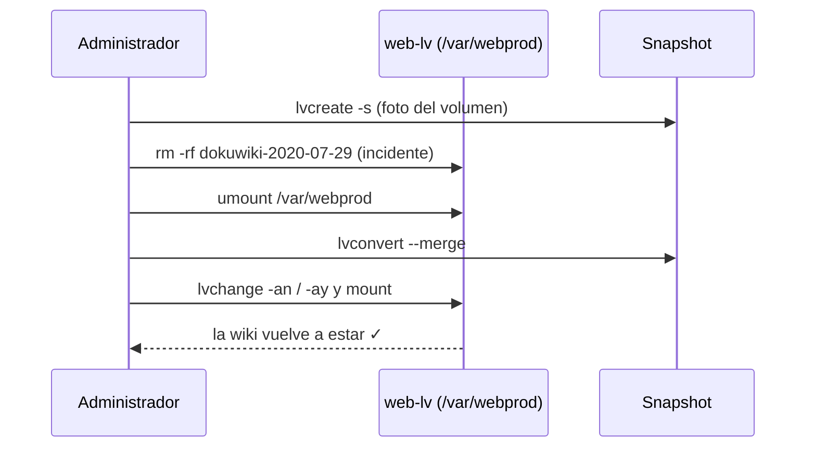

# LVM, RAID y snapshots · recuperar una wiki sin reinstalar

> Práctica AP5 del módulo 0369 *Implantación de sistemas operativos* (2º ASIR, Digitech FP). RA3: asegurar la información con copias de seguridad y sistemas tolerantes a fallos.


## El reto

Un servidor guarda la wiki interna del departamento (DokuWiki, con parte web y base de datos MySQL). Alguien borra por error todo el código. Hay que:

1. Diseñar un almacenamiento **flexible**, que se pueda ampliar sin parar el servicio.
2. Poder **volver atrás en segundos** tras un borrado.
3. Proponer un **plan de copias** completo para la wiki.

## La solución

### Parte 1 · RAID en Windows Server
Con nueve discos virtuales en VirtualBox y tabla GPT:

- **RAID 0** (volumen seccionado) con dos discos de 4 GB.
- **RAID 1** (espejo) de 3 GB llamado `DADES` y, con el espacio sobrante, un **volumen distribuido**.
- **RAID 5** con tres discos de 8 GB.
- Volumen simple y volumen distribuido entre dos discos.

### Parte 2 · LVM en Ubuntu Server
| Paso | Comando |
|---|---|
| Volúmenes físicos | `pvcreate /dev/sdb1 /dev/sdc1` |
| Grupo de volúmenes | `vgcreate info-vg /dev/sdb1 /dev/sdc1` |
| Volumen lógico de 2 GB | `lvcreate -L 2G -n web-lv info-vg` |
| Formato y montaje | `mkfs.ext4` + `/var/webprod` en `/etc/fstab` |
| **Ampliación en caliente** a 2,5 GB | `lvextend -L 2.5G` + `resize2fs` |
| **Snapshot fechado** | `lvcreate -L 500M -s -n web-lv_snapshot_AAAAMMDD /dev/info-vg/web-lv` |
| Restauración | `lvconvert --merge` |
| Disco para copias | `pvmove` + `vgreduce` → nuevo `backups-vg/tar-lv` de 1 GB |

### Parte 3 · Copias con tar
Completa, **incremental** y **diferencial** con `tar -g` y ficheros `.snar` ([scripts/04_backups_tar.sh](scripts/04_backups_tar.sh)).

## El incidente y la recuperación



## Problema real que me encontré

Al lanzar `lvconvert --merge` con `/var/webprod` **montado**, y además desde dentro de ese directorio, la fusión no se aplicaba y daba error. LVM deja el merge pendiente hasta que el volumen de origen se reactiva.

**Solución:** salir del directorio, `umount /var/webprod`, hacer el merge, desactivar y activar el volumen (`lvchange -an` y `lvchange -ay`) y volver a montarlo. Después, `ls -l /var/webprod` mostraba la wiki restaurada.

## Estructura

```
lvm-snapshots-dokuwiki/
├── scripts/
│   ├── 01_crear_lvm.sh                 # PV, VG, LV, montaje y ampliación
│   ├── 02_snapshot_y_restauracion.sh   # Snapshot, borrado simulado y merge
│   ├── 03_disco_de_backups.sh          # pvmove, vgreduce y backups-vg
│   └── 04_backups_tar.sh               # Completa, incremental y diferencial
└── docs/capturas/
```

> ⚠ Los scripts borran el contenido de los discos que se les indiquen. Úsalos solo en una máquina virtual.

## Plan de copias propuesto para la wiki

- **Código y ficheros:** snapshot LVM antes de cada cambio y `tar` completo semanal con incrementales diarios en `backups-vg`.
- **Base de datos MySQL:** `mysqldump` diario, guardado junto a la copia de ficheros.
- **Fuera del servidor:** copia semanal a un disco externo, aplicando la regla 3-2-1.

## Lo que aprendí

- Un snapshot **no es un backup**: vive en el mismo grupo de volúmenes. Sirve para deshacer rápido, no para sobrevivir a un fallo de disco.
- LVM permite crecer sin parar el servicio, algo que una partición clásica no permite.
- Incremental y diferencial no son lo mismo: el diferencial siempre parte de la última **completa**.

## Autoría

Fabrizio Barrial · 2º ASIR, Digitech FP.
