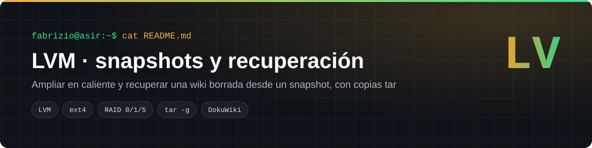
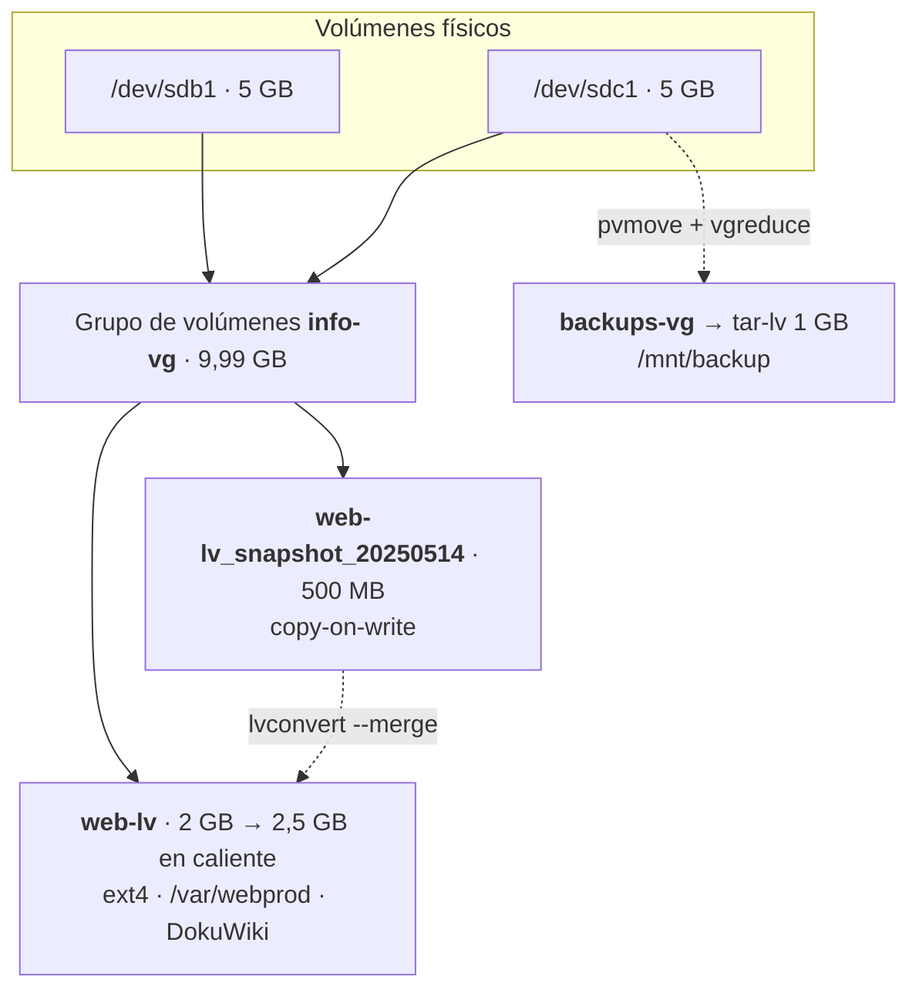
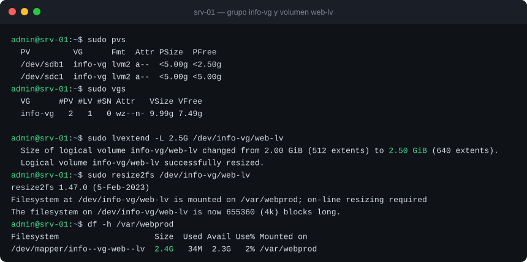
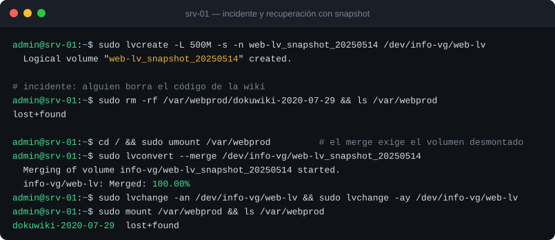
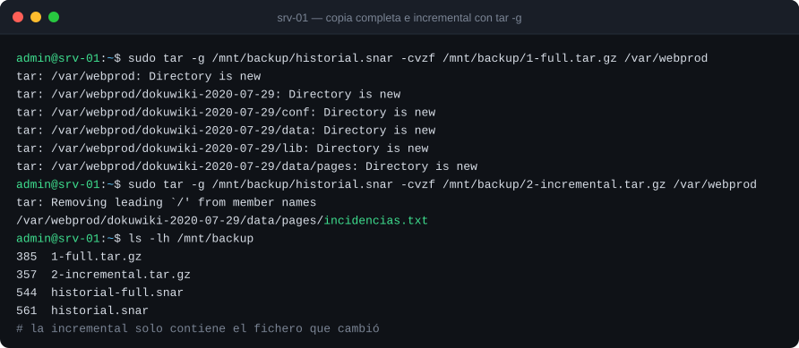
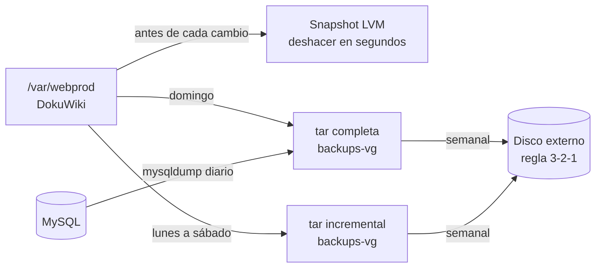

<p align="center"></p>

<p align="center">
  
  
  
  
</p>

Práctica AP5 del módulo 0369 *Implantación de sistemas operativos* (2º ASIR, Digitech FP). Resultado de aprendizaje 3: asegurar la información del sistema con copias de seguridad y sistemas tolerantes a fallos. El caso: un servidor con la wiki interna del departamento (DokuWiki) **pierde todo su código por un borrado accidental** y hay que recuperarlo sin reinstalar.

## Índice
- [El reto](#el-reto)
- [Arquitectura](#arquitectura)
- [Despliegue paso a paso](#despliegue-paso-a-paso)
- [Verificación](#verificación)
- [El problema real que me encontré](#el-problema-real-que-me-encontré)
- [Plan de copias para la wiki](#plan-de-copias-para-la-wiki)
- [Estructura del repositorio](#estructura-del-repositorio)

## El reto

1. Montar un almacenamiento **flexible**, que se pueda ampliar sin parar el servicio.
2. Poder **volver atrás en segundos** tras un borrado.
3. Comparar los niveles de RAID de Windows Server y proponer un **plan de copias** completo.

## Arquitectura

### LVM en Ubuntu Server



### RAID en Windows Server (nueve discos virtuales, GPT)

| Volumen | Discos | Capacidad útil | Tolera la pérdida de |
|---|---|---|---|
| RAID 0 (seccionado) | 2 × 4 GB | 8 GB | ningún disco |
| RAID 1 `DADES` (espejo) | 2 × 3 GB | 3 GB | 1 disco |
| Distribuido (spanned) | resto de los discos | suma de los trozos | ningún disco |
| RAID 5 (paridad) | 3 × 8 GB | 16 GB | 1 disco |
| Simple + distribuido `Dades` | discos 8 y 9 | 2 GB + 3 GB | ningún disco |

## Despliegue paso a paso

> ⚠ Los scripts formatean los discos que se les indiquen. Úsalos solo en una máquina virtual.

```bash
# 1) PV, VG y LV, montaje persistente y ampliación en caliente
sudo DISCOS="/dev/sdb1 /dev/sdc1" bash scripts/01_crear_lvm.sh

# 2) Instalar la wiki en el volumen
cd /var/webprod && sudo wget https://download.dokuwiki.org/src/dokuwiki/dokuwiki-stable.tgz
sudo tar -xzvf dokuwiki-stable.tgz

# 3) Snapshot, borrado simulado y recuperación
sudo bash scripts/02_snapshot_y_restauracion.sh

# 4) Segundo disco para copias y copias con tar
sudo DISCO=/dev/sdc1 bash scripts/03_disco_de_backups.sh
sudo bash scripts/04_backups_tar.sh
```

## Verificación

**Grupo de volúmenes y ampliación en caliente sin desmontar**



**Del borrado a la wiki recuperada**



**Copia completa e incremental** (ejecución real de `tar -g`: la incremental solo guarda lo que cambió)



| Prueba | Resultado | Estado |
|---|---|:-:|
| `lvextend` + `resize2fs` con el volumen montado | `df -h` muestra 2,4 G sin cortar el servicio | ✅ |
| Snapshot antes del cambio | `web-lv_snapshot_20250514` creado (500 MB) | ✅ |
| Borrado de `dokuwiki-2020-07-29` | `/var/webprod` vacío | ✅ |
| `lvconvert --merge` + reactivación | La carpeta vuelve completa | ✅ |
| Incremental tras un cambio | Solo contiene el fichero modificado | ✅ |

> La captura de `tar` es una ejecución real. Las de LVM están reproducidas en SVG a partir de las de la práctica.

## El problema real que me encontré

Lancé `lvconvert --merge` con `/var/webprod` **montado** y desde dentro de ese mismo directorio. La fusión no se aplicaba y daba error, porque LVM deja el merge pendiente hasta que el volumen de origen se reactiva.

**Solución:** salir del directorio, `umount /var/webprod`, hacer el merge, desactivar y activar el volumen (`lvchange -an` y `lvchange -ay`) y volver a montar. Ahora está incluido en [`02_snapshot_y_restauracion.sh`](scripts/02_snapshot_y_restauracion.sh).

## Plan de copias para la wiki



| Copia | Frecuencia | Para qué |
|---|---|---|
| Snapshot LVM | antes de cada actualización | Deshacer un error al momento |
| `tar` completa | semanal | Punto de partida de la restauración |
| `tar` incremental | diaria | Lo cambiado desde la última copia |
| `tar` diferencial | alternativa a la incremental | Lo cambiado desde la última **completa**: restaurar requiere solo 2 ficheros |
| `mysqldump` | diaria | Base de datos de la wiki |
| Externa | semanal | Sobrevivir a la pérdida del servidor |

## Estructura del repositorio

```
lvm-snapshots-dokuwiki/
├── scripts/
│   ├── 01_crear_lvm.sh                 PV, VG, LV, fstab y ampliación
│   ├── 02_snapshot_y_restauracion.sh   Snapshot, borrado simulado y merge
│   ├── 03_disco_de_backups.sh          pvmove, vgreduce y backups-vg
│   └── 04_backups_tar.sh               Completa, incremental y diferencial
└── docs/img/
```

## Lo que aprendí

- Un snapshot **no es un backup**: vive en el mismo grupo de volúmenes. Sirve para deshacer rápido, no para sobrevivir a un fallo de disco.
- LVM permite crecer sin parar el servicio, algo que una partición clásica no permite.
- Incremental y diferencial no son lo mismo: el diferencial siempre parte de la última **completa**.

---
**Autoría:** Fabrizio Barrial · 2º ASIR, Digitech FP. · [Portfolio](https://fabrizio2032-svc.github.io/portfolio/)
