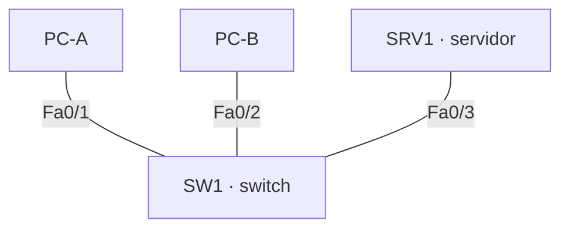
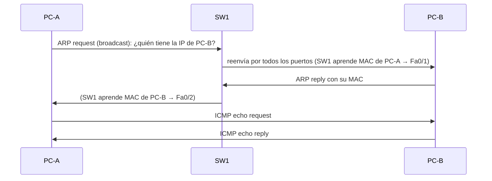

# PT01 · Primera LAN de NexaTech en Cisco Packet Tracer

> Práctica del módulo 0370 *Planificación y administración de redes* (2º ASIR, Digitech FP), hecha con Cisco Packet Tracer 9.0. El objetivo no era solo que la red funcionara, sino **saber explicar por qué funciona** y diagnosticar un fallo sin cambiar nada a ciegas.


## El reto

NexaTech abre una oficina con dos puestos y un pequeño servidor de documentos, todavía sin Internet. Hay que montar la red más sencilla posible (dos PC, un servidor, un switch y tres cables) y entender lo que pasa dentro.

## Topología



Los tres equipos comparten la misma subred **/24**, sin router ni Wi-Fi a propósito: así todo lo que se observa es tráfico de la LAN.

## Lo que hice

1. **Direccionamiento:** cálculo de por qué dos hosts son "vecinos" (misma red y misma máscara) y asignación de IP a cada equipo.
2. **Montaje físico:** conexión de cada equipo a su puerto del switch y comprobación de los enlaces.
3. **Modo simulación:** seguimiento paso a paso del primer `ping`.
4. **Tabla MAC del switch:** cómo SW1 aprende la MAC de origen de cada trama y la asocia a un puerto (`show mac address-table`).
5. **Diagnóstico de dos incidentes provocados:**
   - Un PC con la IP en **otra subred**.
   - Dos PC con **máscaras distintas**.

   En ambos casos el diagnóstico se hizo comprobando antes de cambiar: `ipconfig /all`, `ping`, `arp -a`, `arp -d` y la tabla MAC.

## Qué pasa en el primer ping



## Lo que aprendí

- **Observar un fallo no es lo mismo que identificar la causa**: primero se mira la configuración, luego se cambia.
- PC-A necesita la **MAC** de PC-B antes de enviarle nada, y por eso el primer ping siempre va precedido de ARP.
- Un switch no "sabe" de IP: aprende MAC por puerto.

## Estructura

```
nexatech-lan-packet-tracer/
├── packet-tracer/   # archivo .pkt de la práctica
└── docs/capturas/   # simulación, tabla MAC y diagnósticos
```

## Autoría

Fabrizio Barrial · 2º ASIR, Digitech FP.
