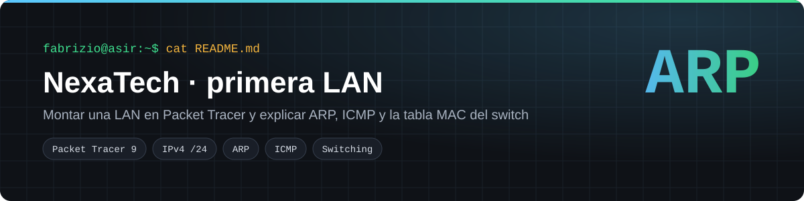
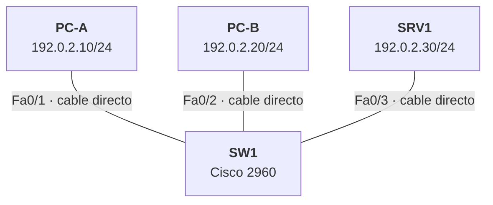
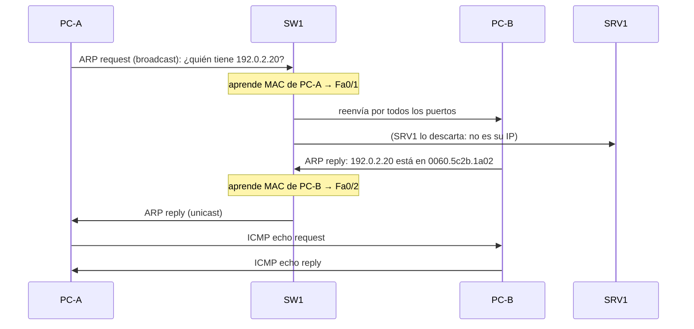
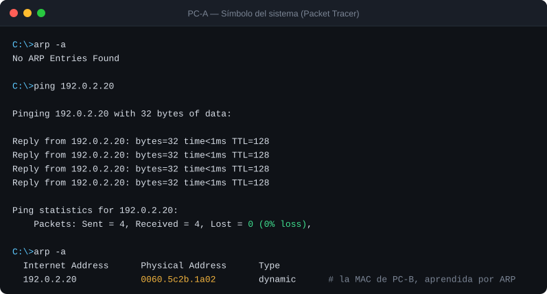
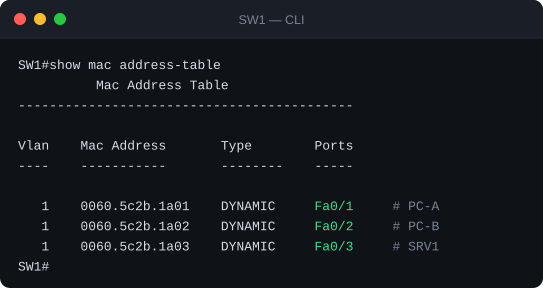
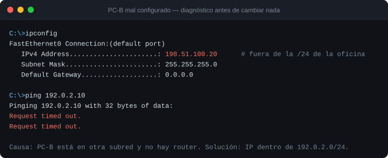

  
  
  

Práctica PT01 del módulo 0370 *Planificación y administración de redes* (2º ASIR, Digitech FP), hecha con Cisco Packet Tracer 9.0. NexaTech abre una oficina con dos puestos y un pequeño servidor de documentos, todavía sin Internet. El objetivo no era solo que la red funcionara, sino **saber explicar por qué funciona** y diagnosticar un fallo sin cambiar nada a ciegas.

## Índice
- [Topología](#topología)
- [Direccionamiento](#direccionamiento)
- [Montaje paso a paso](#montaje-paso-a-paso)
- [Qué pasa en el primer ping](#qué-pasa-en-el-primer-ping)
- [Verificación](#verificación)
- [Diagnóstico de incidentes](#diagnóstico-de-incidentes)

## Topología

La red es mínima a propósito: sin router ni Wi-Fi, así todo lo que se observa es tráfico de la LAN.

## Direccionamiento

| Equipo | Interfaz | Puerto del switch | IPv4 | Máscara | Puerta de enlace |
|---|---|---|---|---|---|
| PC-A | FastEthernet0 | Fa0/1 | 192.0.2.10 | 255.255.255.0 (/24) | — (no hay router) |
| PC-B | FastEthernet0 | Fa0/2 | 192.0.2.20 | 255.255.255.0 (/24) | — |
| SRV1 | FastEthernet0 | Fa0/3 | 192.0.2.30 | 255.255.255.0 (/24) | — |

**Por qué son vecinos:** con máscara /24, los tres primeros octetos identifican la red. `192.0.2.10` y `192.0.2.20` comparten `192.0.2.0/24`, así que se hablan directamente por el switch, sin router.

> Se usa el rango de documentación RFC 5737 en lugar del direccionamiento del aula.

## Montaje paso a paso

1. Coloca un switch **2960** (SW1), dos **PC** y un **Server**.
2. Conecta cada equipo con **cable directo de cobre** a Fa0/1, Fa0/2 y Fa0/3. Espera a que los enlaces pasen de ámbar a verde.
3. En cada equipo: *Desktop › IP Configuration › Static* e introduce la IP y la máscara de la tabla.
4. Comprueba en *Desktop › Command Prompt* con `ipconfig /all`.
5. Pasa a **modo Simulación**, filtra por **ARP** e **ICMP** y lanza un `ping` de PC-A a PC-B para verlo paquete a paquete.
6. Revisa en SW1 (*CLI*) la tabla MAC con `show mac address-table`.

## Qué pasa en el primer ping

## Verificación

**Ping correcto y caché ARP antes y después**

**El switch aprende cada MAC en su puerto**

| Prueba | Resultado | Estado |
|---|---|:-:|
| `ping` PC-A → PC-B | 4 enviados, 4 recibidos, 0 % de pérdida | ✅ |
| `ping` PC-A → SRV1 | Respuesta correcta | ✅ |
| `arp -a` en PC-A tras el ping | Aparece la MAC de PC-B | ✅ |
| `show mac address-table` | Fa0/1, Fa0/2 y Fa0/3 con su MAC | ✅ |

> Las capturas de consola están reproducidas en SVG a partir de las de la práctica.

## Diagnóstico de incidentes

Se provocaron dos fallos para practicar el método: **observar, comprobar la configuración y solo entonces cambiar**.

| Incidente | Síntoma | Comprobación | Causa | Solución |
|---|---|---|---|---|
| IP en otra subred | `Request timed out` | `ipconfig`: PC-B en `198.51.100.20` | Sin router no hay camino entre subredes | IP dentro de `192.0.2.0/24` |
| Máscaras distintas | Ping en un sentido sí y en el otro no | `ipconfig /all` en ambos | Cada equipo calcula una red distinta | Misma máscara /24 en todos |

Comandos de diagnóstico usados: `ipconfig`, `ipconfig /all`, `ping`, `arp -a`, `arp -d` y `show mac address-table`.

## Lo que aprendí

- **Observar un fallo no es identificar la causa**: primero se mira la configuración y luego se cambia.
- PC-A necesita la **MAC** de PC-B antes de enviarle nada, y por eso el primer ping siempre va precedido de ARP.
- Un switch no sabe de IP: aprende MAC por puerto y reenvía las tramas según esa tabla.

---
**Autoría:** Fabrizio Barrial · 2º ASIR, Digitech FP. · [Portfolio](https://fabrizio2032-svc.github.io/portfolio/)
