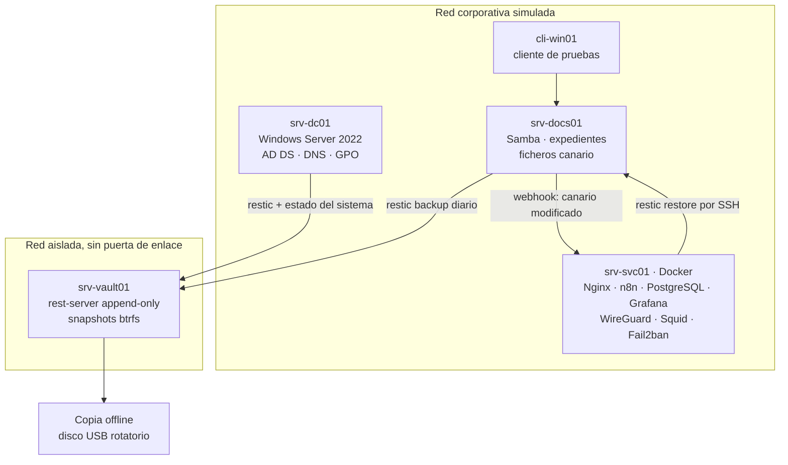

# Resiliencia frente a ransomware · laboratorio virtualizado

> Proyecto intermodular de 2º de ASIR (Digitech FP). Parte de un caso real de 2026: un colegio profesional con los servidores cifrados por ransomware. Trabajo en equipo de tres. **Estado: en curso.**


## El reto

El acceso inicial de un atacante no se puede descartar al cien por cien. Lo que sí se puede preparar es **la capacidad de recuperarse**:

- Copias que el atacante **no pueda borrar ni cifrar**, aunque llegue a ser administrador del dominio.
- Detectar un cifrado masivo **en minutos**.
- Restaurar con un procedimiento **ensayado**, con objetivos medibles: **RTO de 4 h** y **RPO de 24 h**.

## La solución

| Capa | Qué monté |
|---|---|
| Entorno corporativo | `srv-dc01` con Windows Server 2022 (AD DS, DNS, GPO) y `srv-docs01` con Samba (expedientes, SMB3 cifrado) |
| Bóveda de copias | `srv-vault01` en una **red aislada** con `rest-server --append-only`, snapshots de btrfs y copia offline en USB (modelo 3-2-1-1-0) |
| Credenciales | Las de restic son **independientes del dominio** y se guardan fuera de línea |
| Detección | **Ficheros canario** vigilados con inotify y control de anomalías en el tamaño de las copias |
| Automatización | **n8n** recibe el webhook, calcula una huella para evitar duplicados, clasifica, avisa y lanza la restauración con rollback |
| Trazabilidad | **PostgreSQL** guarda copias, incidentes y restauraciones; **Grafana** muestra el estado de todo |
| Perímetro | **WireGuard** como único acceso de administración, **Squid** con lista blanca de salida y **Fail2ban** |

## Arquitectura



**Principio de diseño:** ninguna cuenta del dominio, ni siquiera la de administrador, puede eliminar las copias. Se combina el modo append-only, credenciales separadas, cortafuegos que solo acepta tres orígenes, snapshots en solo lectura y una copia offline.

## Flujo ante un ataque

1. Un fichero canario se modifica, o el tamaño de la copia se dispara.
2. `scripts/canario.sh` envía un webhook a n8n con una huella del evento.
3. n8n registra el incidente en PostgreSQL, lo clasifica por gravedad y avisa al equipo.
4. Se restaura desde la bóveda con `restic restore` a un entorno limpio, sin sobrescribir la versión afectada.
5. Si algo falla, un workflow de **Error Trigger** revierte y deja constancia.

## Estructura del repositorio

```
ransomware-resiliencia-lab/
├── docker-compose.yml        # Pila de srv-svc01 (versiones fijadas)
├── .env.example              # Variables sin secretos; el .env real no se sube
├── initdb/01_schema.sql      # Tablas de sistemas, copias, incidentes y restauraciones
├── nginx/default.conf        # Formulario de incidencias con limitación de peticiones
├── web/index.html            # Formulario para el personal
├── boveda/                   # rest-server append-only y cortafuegos de la bóveda
├── scripts/
│   ├── backup_restic.sh      # Copia diaria y verificación de integridad
│   └── canario.sh            # Vigilancia de ficheros señuelo → webhook a n8n
├── samba/ squid/ fail2ban/ wireguard/   # Configuración de cada servicio
├── grafana/estado_copias.sql # Consulta del panel de estado
└── docs/memoria-proyecto.md  # Memoria completa: viabilidad, presupuesto, riesgos y manuales
```

## Cómo levantar la pila de servicios

```bash
# En srv-svc01, con Docker Engine y el plugin Compose instalados
sudo mkdir -p /opt/resiliencia && sudo cp -r . /opt/resiliencia && cd /opt/resiliencia
cp .env.example .env && chmod 600 .env   # rellena las contraseñas
docker compose up -d
docker compose ps                         # los cuatro servicios en "running"
```

## Riesgos que he tenido en cuenta

| Riesgo | Medida |
|---|---|
| Copias corruptas sin detectar | `restic check` periódico y ensayo de restauración semanal |
| Falsos positivos de los canarios | Ventanas de mantenimiento y lista de procesos permitidos |
| Fallos de webhooks al pasar a producción | Validar URLs y variables de entorno en un entorno de pruebas |

## Lo que estoy aprendiendo

- Un backup al alcance del administrador del dominio **no sirve** contra ransomware: la separación de credenciales y de red es lo que marca la diferencia.
- Automatizar la respuesta con n8n reduce el tiempo entre la detección y la restauración.
- Medir el RTO y el RPO convierte un "creo que funciona" en una prueba demostrable.

## Autoría

Fabrizio Barrial y dos compañeros de 2º de ASIR en Digitech FP. Todos los datos del laboratorio son ficticios. Las direcciones IP aparecen como marcadores (`<IP_SRV_SVC01>`, `<RED_VPN>`…).
