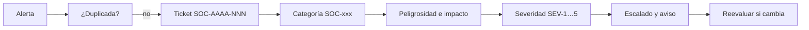

# SOC escolar · clasificación de amenazas y catálogo de riesgos

> Actividad A2 del módulo *Seguridad Informática y Alta Disponibilidad* (2º ASIR, Digitech FP). El grupo hace de operadores y analistas de un **Centro de Operaciones de Seguridad** que protege la infraestructura TIC de un centro educativo. **Estado: en curso** (sesión 1 de 4).

## El reto

Antes de monitorizar tráfico o configurar antivirus, un SOC necesita **un lenguaje común**: qué se protege, por dónde pueden llegar los ataques, cómo se llama cada tipo de incidente y qué prioridad tiene. Sin eso, dos analistas pueden ver la misma alerta y tratarla de forma distinta.

## Lo que hice en la sesión 1

1. **Inventario de 10 activos** del centro (controlador de dominio, NAS de copias, Moodle, Wi-Fi, IoT…) con su criticidad.
2. **11 vectores de ataque** relacionados con los activos a los que afectan (phishing, USB, credenciales débiles, servicios expuestos…).
3. **Clasificación de amenazas** con la taxonomía de referencia nacional de **INCIBE-CERT y CCN-CERT**.
4. **Taxonomía propia del SOC** (SOC-MAL, SOC-PHI, SOC-REC, SOC-ACC…) con niveles de severidad, tiempos de respuesta y escalado.
5. **Catálogo de 13 riesgos** valorados por probabilidad × impacto, con su mapa de calor y la contramedida principal de cada uno.

## Niveles de severidad

| Severidad | Criterio | Ejemplo | Respuesta |
|---|---|---|---|
| 🔴 **SEV-1 Crítica** | Servicios esenciales caídos, propagación activa o datos de menores expuestos | Ransomware cifrando el NAS | < 15 min |
| 🟠 **SEV-2 Alta** | Servidor o cuenta privilegiada afectados, sin propagación | Cuenta de profesor comprometida | < 1 h |
| 🔵 **SEV-3 Media** | Uno o pocos equipos de usuario afectados | Troyano en un equipo de aula | < 4 h |
| 🟢 **SEV-4 Baja** | Intento fallido o actividad sospechosa sin éxito | Escaneo de puertos bloqueado | < 24 h |
| ⚪ **SEV-5 Informativa** | Evento registrado sin riesgo | Falso positivo del antivirus | Semanal |

## Procedimiento de clasificación

## Riesgos prioritarios

| ID | Riesgo | P × I | Contramedida principal |
|---|---|---|---|
| R-02 | Robo de credenciales del profesorado por phishing | 4 × 4 = **16** | MFA en correo y Moodle, filtro antiphishing y formación |
| R-01 | Ransomware que cifra servidores y el NAS de copias | 3 × 5 = **15** | Copias 3-2-1 con una copia desconectada, EDR y NAS segmentado |
| R-04 | Fuerza bruta contra RDP/SSH expuestos | 3 × 4 = **12** | Sin RDP publicado, acceso por VPN, fail2ban y claves SSH |

El informe completo, con todas las tablas, el ejemplo de ticket y el mapa de calor, está en [docs/sesion-1-clasificacion-amenazas.md](docs/sesion-1-clasificacion-amenazas.md).

## Lo que aprendí

- Clasificar bien es lo que hace que la respuesta sea rápida y coherente, más que la herramienta.
- Una fuga de datos personales no es solo un problema técnico: el **artículo 33 del RGPD** obliga a notificarla a la AEPD en 72 horas.
- Phishing y ransomware comparten parte de la solución: el phishing suele ser la puerta de entrada del ransomware.

## Autoría

Fabrizio Barrial · 2º ASIR, Digitech FP. Centro educativo y datos de ejemplo ficticios.
