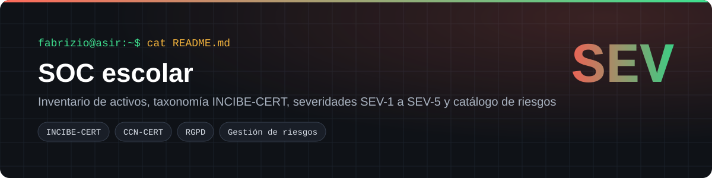
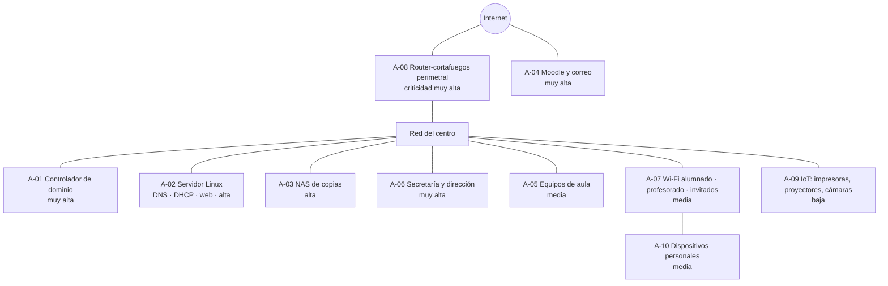
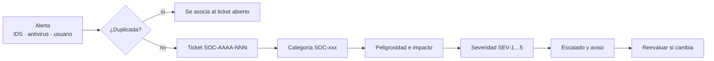
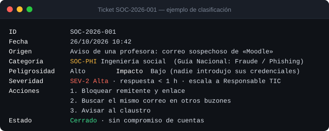
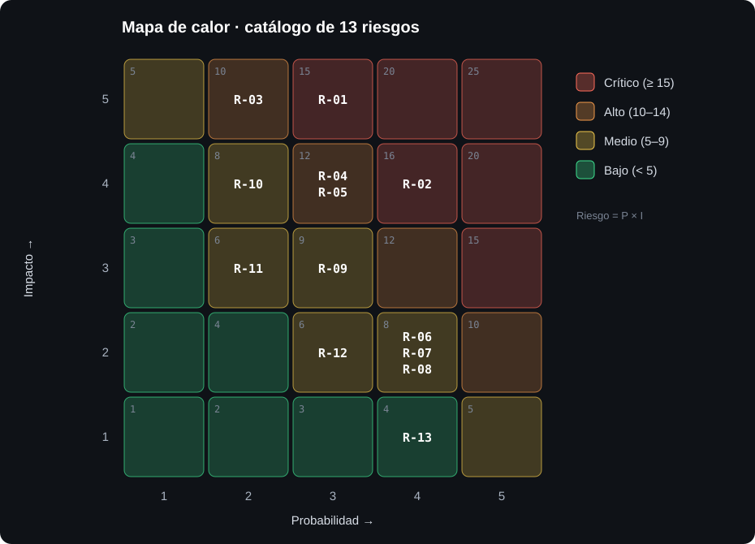

<p align="center"></p>

<p align="center">
  
  
  
</p>

Actividad A2 del módulo *Seguridad Informática y Alta Disponibilidad* (2º ASIR, Digitech FP). El grupo hace de operadores y analistas de un **Centro de Operaciones de Seguridad (SOC)** que protege la infraestructura TIC de un centro educativo: monitorizar, detectar, clasificar y responder ante incidentes. Este repositorio recoge la **sesión 1**, que construye el marco común que se usará en las sesiones 2, 3 y 4.

## Índice
- [El reto](#el-reto)
- [Arquitectura del centro](#arquitectura-del-centro)
- [Taxonomía y severidades](#taxonomía-y-severidades)
- [Procedimiento de clasificación](#procedimiento-de-clasificación)
- [Catálogo de riesgos](#catálogo-de-riesgos)
- [Cómo usar este marco](#cómo-usar-este-marco)
- [Estructura del repositorio](#estructura-del-repositorio)

## El reto

Antes de monitorizar tráfico o configurar antivirus, un SOC necesita **un lenguaje común**: qué se protege, por dónde pueden llegar los ataques, cómo se llama cada tipo de incidente y qué prioridad tiene. Sin eso, dos analistas pueden ver la misma alerta y tratarla de forma distinta.

| Entregable | Contenido |
|---|---|
| Inventario | 10 activos TIC con su criticidad |
| Vectores | 11 vías de ataque relacionadas con los activos |
| Clasificación | Amenazas según la taxonomía nacional de INCIBE-CERT y CCN-CERT |
| Taxonomía propia | 9 categorías SOC-xxx y 5 niveles de severidad |
| Catálogo | 13 riesgos valorados por probabilidad × impacto, con contramedida |

## Arquitectura del centro



## Taxonomía y severidades

| Código | Categoría | Ejemplos | Guía nacional |
|---|---|---|---|
| SOC-MAL | Código dañino | Virus, troyanos, ransomware, criptominería | Contenido dañino; Fraude |
| SOC-PHI | Ingeniería social | Phishing, suplantación, llamadas fraudulentas | Fraude; Obtención de información |
| SOC-REC | Reconocimiento | Escaneos de red, sniffing | Obtención de información |
| SOC-ACC | Acceso no autorizado | Fuerza bruta, explotación, cuentas comprometidas | Intento de intrusión; Intrusión |
| SOC-DAT | Datos | Fuga, alteración o pérdida de información | Compromiso de la información |
| SOC-DIS | Disponibilidad | Caídas, DoS/DDoS, sabotaje | Disponibilidad |
| SOC-VUL | Vulnerabilidad | Software sin parchear, mala configuración | Vulnerable |
| SOC-USO | Uso indebido | Software no autorizado, BYOD fuera de norma | Contenido abusivo; Fraude |
| SOC-OTR | Otros | Lo que no encaja en lo anterior | Otros |

| Severidad | Criterio | Ejemplo | Respuesta | Escalado |
|---|---|---|---|---|
| 🔴 **SEV-1 Crítica** | Servicios esenciales caídos, propagación activa o datos de menores expuestos | Ransomware cifrando el NAS | < 15 min | Coordinación TIC y dirección; INCIBE-CERT/CCN-CERT y AEPD si procede |
| 🟠 **SEV-2 Alta** | Servidor o cuenta privilegiada afectados, sin propagación | Cuenta de profesor comprometida | < 1 h | Responsable TIC |
| 🔵 **SEV-3 Media** | Uno o pocos equipos de usuario | Troyano en un equipo de aula | < 4 h | Analista de turno |
| 🟢 **SEV-4 Baja** | Intento fallido o actividad sospechosa sin éxito | Escaneo de puertos bloqueado | < 24 h | Revisión diaria |
| ⚪ **SEV-5 Informativa** | Evento registrado sin riesgo | Falso positivo del antivirus | Semanal | Ninguno |

La severidad sale del mayor de dos valores, peligrosidad o impacto, y **sube un nivel** si hay datos personales de menores.

## Procedimiento de clasificación



**Ejemplo real de la sesión: un correo falso de Moodle**



## Catálogo de riesgos



| ID | Riesgo | P | I | R | Nivel | Contramedida principal |
|---|---|:-:|:-:|:-:|---|---|
| R-02 | Robo de credenciales del profesorado por phishing | 4 | 4 | **16** | 🔴 Crítico | MFA en correo y Moodle, filtro antiphishing, formación |
| R-01 | Ransomware que cifra servidores y el NAS de copias | 3 | 5 | **15** | 🔴 Crítico | Copias 3-2-1 con una desconectada, EDR, NAS segmentado |
| R-04 | Fuerza bruta contra RDP/SSH expuestos | 3 | 4 | **12** | 🟠 Alto | Sin RDP publicado, VPN, fail2ban, claves SSH |
| R-05 | Vulnerabilidad en Moodle | 3 | 4 | **12** | 🟠 Alto | Gestión de parches y revisión de plugins |
| R-03 | Fuga de datos personales del alumnado | 2 | 5 | **10** | 🟠 Alto | Permisos por rol, cifrado, registro de accesos |
| R-09 | Interceptación de tráfico en la Wi-Fi | 3 | 3 | 9 | 🟡 Medio | WPA2/WPA3-Enterprise, SSID separados |
| R-06 | Malware por USB en equipos de aula | 4 | 2 | 8 | 🟡 Medio | Análisis de extraíbles, autorun desactivado por GPO |
| R-07 | Software no autorizado | 4 | 2 | 8 | 🟡 Medio | Usuarios sin privilegios, AppLocker |
| R-08 | Escaneos y ataques internos desde aulas | 4 | 2 | 8 | 🟡 Medio | VLAN de aulas aislada, IDS (Snort/Suricata) |
| R-10 | Acceso físico al armario de red | 2 | 4 | 8 | 🟡 Medio | Rack con llave, bloqueo de sesión, contraseña de BIOS |
| R-11 | DDoS contra la plataforma educativa | 2 | 3 | 6 | 🟡 Medio | Protección del proveedor, plan de continuidad |
| R-12 | Compromiso de un dispositivo IoT | 3 | 2 | 6 | 🟡 Medio | Credenciales por defecto cambiadas, VLAN de IoT |
| R-13 | Spam en el correo | 4 | 1 | 4 | 🟢 Bajo | Filtros antispam |

## Cómo usar este marco

1. Cada alerta entra por el procedimiento anterior y recibe un ticket `SOC-AAAA-NNN`.
2. Se asigna una categoría de la taxonomía y se valoran la peligrosidad y el impacto con las tablas del [informe](docs/sesion-1-clasificacion-amenazas.md).
3. La severidad decide el tiempo de respuesta y a quién se escala.
4. Si hay datos personales, se valora la notificación a la AEPD en **72 horas** (art. 33 del RGPD).
5. Los riesgos R-01 y R-02 marcan el trabajo de las sesiones siguientes: monitorización, análisis de muestras y respuesta.

## Estructura del repositorio

```
soc-escolar/
└── docs/
    ├── sesion-1-clasificacion-amenazas.md   Informe completo de la sesión 1
    └── img/                                 Mapa de calor, ticket de ejemplo y portada
```

## Lo que aprendí

- Clasificar bien es lo que hace que la respuesta sea rápida y coherente, más que la herramienta.
- Una fuga de datos personales no es solo técnica: el art. 33 del RGPD obliga a notificarla en 72 h.
- Phishing y ransomware comparten solución: el phishing suele ser la puerta de entrada del ransomware.

---
**Autoría:** Fabrizio Barrial · 2º ASIR, Digitech FP. Centro y datos de ejemplo ficticios. · [Portfolio](https://fabrizio2032-svc.github.io/portfolio/)
